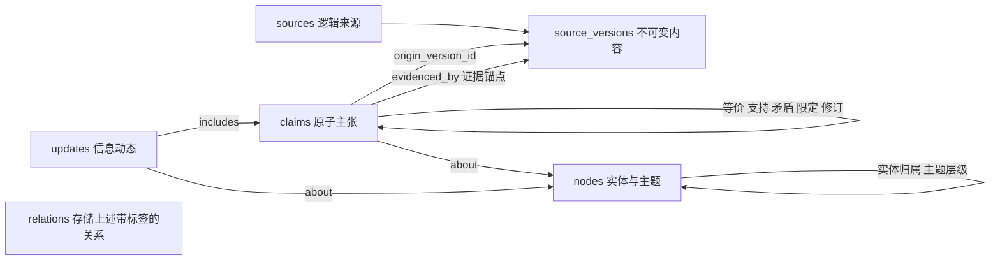

# AI 多来源信息聚合平台：开发需求与实施规范

版本：1.2 ｜ 日期：2026-10-19 ｜ 文档语言：中文 ｜ 交付对象：Codex 与项目开发者

本版变更：保留v1.1全部管理界面要求，新增来源可靠性画像、主张事实核查、版本化核查记录、服务端发布门槛和纠错传播。原文证据只能证明来源表达过某项主张，不代表该主张真实；抽取置信度不能作为事实可信度。

> 产品定位：把分散来源中的主张、证据、分歧和变化，组织成可持续更新的信息知识库。首页展示“发生了什么、与我关注的对象有什么关系、证据在哪里”，不是视频推荐列表。
>
> 本文中的 MUST 为发布阻断要求，SHOULD 为默认实现要求。未注明为后续阶段的要求均属于 MVP。本文是需求和设计基线，不代表软件已实现或已通过验收。

## 0. 背景、依据与实施决策

### 0.1 前序讨论的承接边界

已读取“呈现方式优化”的用户讨论：用户明确要求以信息聚合为主；同一个插件可能被多个视频从不同角度讨论，包括批评；需要解决主题、实体、单个视频之间的颗粒度问题，并控制 AI 成本、支持模型选择和后续视频平台扩展。历史助手回复仅返回内容引用标记，无法恢复原来的表结构。因此，本文的六表设计是本次完整提出的实施方案，不声称逐字复原此前方案。

### 0.2 核心决策

1. 信息粒度分层：主题用于导航，实体用于持续关注，主张用于保存观点与事实陈述，信息动态用于展示变化，来源用于证据回溯。
2. MVP 是单用户、单工作区的独立 Web 应用，默认本机部署；保留 `workspace_id` 作为未来隔离边界。多租户 SaaS 不在 MVP。
3. 先落地 B站采集，同时提供用户手动导入文本/Markdown/SRT/VTT，证明核心业务并不依赖视频。YouTube 首期提供适配器契约与测试替身，真实联网实现列入后续里程碑。
4. 六张核心业务表，不强行把任务、密钥、预算塞进业务表；运行支撑表单独设计。
5. 所有 AI 调用经过统一网关；规则任务不调用模型；每类任务可单独选择模型、覆盖默认分级配置。
6. 不依赖 DSH：不需要安装、启动、调用 DSH，不读取 DSH 配置、运行时、账号、人设或插件目录。
7. 默认不启用付费模型、自动采集或转写。初次配置必须设置预算和数据发送策略，随后可按用户保存的配置持续运行，无需逐次确认。

### 0.3 参考项目的采用范围

[dsh-bili-scroll README](https://github.com/c1overzz/dsh-bili-scroll) 展示了关键词发现、阅读字幕、可选本地转写、定时执行和 Markdown 日报的思路。本文只借鉴这条处理链；把输出改为跨来源的信息动态与证据网络，不采用自动评论、@用户、回复评论或依赖宿主的运行方式。仓库标注 MIT，但若实际复用代码，必须核对具体文件及其内置依赖的许可证，保留所需声明。[许可证](https://github.com/c1overzz/dsh-bili-scroll/blob/main/LICENSE)

不得照搬该项目中的模型价格、优惠时段或版本假设；本系统价格和调度时段均可配置。

## 1. 业务目标与用户价值

### 1.1 需要回答的五个问题

- 我关注的 AI 开发、AI 插件或某个具体产品，最近有什么实质性新信息？
- 多个来源是在重复同一消息，还是提出了新证据、新条件或不同观点？
- 支持与批评分别基于什么，是否针对相同版本和使用场景？
- 哪些内容只是作者主张，哪些有独立证据佐证，哪些已失效或被更正？
- 如果需要核实，能否直接定位原文或视频时间点？

### 1.2 典型场景与正确颗粒度

示例仅为测试用虚构内容：

- “AI 开发”是一级主题，“AI 插件”是子主题。
- “Plugin X”是具体实体，可以同时属于“AI 插件”和“开发效率”主题。
- 来源 A 称 Plugin X 2.0 支持离线索引；来源 B 演示相同功能；来源 C 批评 1.0 处理大型项目很慢。
- A、B 的相关主张可形成“新增离线索引能力”动态；B 增加证据，不能自动再发一条同义动态。
- C 形成“性能限制”主张。它针对 1.0，不能自动判为对 2.0 离线功能的反驳。
- 若 D 在相同版本、场景下提出离线失败证据，再形成“出现分歧”动态，并保留支持与反对双方。

### 1.3 衡量方式

MVP 以质量、可解释性和成本控制为硬指标：公开动态中的实质性陈述引用覆盖率 100%；机械证据定位校验通过率 100%；相同输入重复处理不增加重复动态；无变化批次不产生生成式 AI 费用；预算控制不能因并发调用失效。具体评测样本、门槛见第 15 节。

上线后收集非阻断产品指标：每日有效动态数、重复内容压缩率、用户打开证据比例、误合并反馈率、每条有效动态成本、从发现到可读的延迟。不得以视频点击量或观看时长作为主目标，也不收集不必要的行为数据。

## 2. MVP 范围与非目标

| 模块 | MVP 必须交付 | 后续能力 |
|---|---|---|
| 来源接入 | B站单链接、关键词发现；手动文本/Markdown/SRT/VTT 导入；采集能力自检 | YouTube、RSS、网页、播客、文档平台 |
| 内容获取 | 平台可合法获取的字幕；缺字幕状态；用户自有字幕上传 | 用户有权处理音频的本地转写；更多语言 |
| 信息加工 | 主张抽取、实体识别、主题关联、去重、条件比较、分歧标记 | 高级事件因果分析、跨语言实体消歧 |
| 信息展示 | 动态流、实体页、主题页、主张详情、来源证据页、搜索 | 可视化关系探索、个性化摘要 |
| 管理 | 关注、已读、收藏、纠错、任务状态、预算与模型设置 | 团队协作、审核角色、多工作区 |
| 报告 | 每日按实体/主题编组的增量摘要、Markdown 下载 | 周报、邮件或其他通知渠道 |
| 模型 | OpenAI 原生适配、通用 OpenAI-compatible 适配、本地兼容端点、Mock | Anthropic/Gemini 等原生协议适配 |
| 运行 | 手动执行、定时执行、失败重试、暂停、取消、恢复、用量账本 | 多节点分布式执行 |

MVP 不做：推荐视频瀑布流、自动播放、评论/私信/点赞、全站抓取、绕过登录或付费限制、自动安装模型、全网事实裁决、自动发布外部消息、通用自主代理、微服务拆分、专用图数据库。

“多来源”首先指多个独立内容来源，并支持视频与人工导入文档两类材料；不以首期接入大量平台换取空壳功能。B站接口无法合法使用或登录失效时，可继续导入和阅读，但不得把导入模式说成 B站联网采集已通过验收。

## 3. 页面、交互与信息架构

### 3.1 全局布局

桌面：左侧导航，中央内容，右侧可展开证据抽屉。移动端：单列，证据为独立全屏面板。默认中文；时间按工作区时区展示，数据库保存 UTC。默认时区 `Asia/Shanghai`，用户可修改。

导航分为阅读区（信息动态 / 关注对象 / 主题 / 来源库 / 日报）和管理区（模型管理 / 平台账号 / 采集与调度 / 任务与费用 / 系统设置）。顶栏统一搜索、导入入口、运行状态和当前用户菜单；用户菜单提供个人设置、会话管理、退出登录。实体与主题分层导航，不把所有数据表直接做成平级菜单。

### 3.2 信息动态首页 `/feed`

默认最近 7 天、按 `first_published_at DESC, id DESC` 游标分页。筛选：关注范围、主题、实体、动态类型、时间、未读、收藏、存在分歧。默认不使用不可解释的推荐排序。

动态卡片必须包含：

```text
[出现分歧] Plugin X 2.0 的离线使用存在条件差异
新增内容：两位作者在不同网络环境下得到不同结果。
适用范围：2.0 / 本地索引 / Windows；其他场景尚未确认
支持 2 项主张 · 限制/反对 1 项主张 · 独立来源组 2
证据检查：引用定位已通过；事实真实性未由系统保证
首次出现时间 | 最近修订时间
[查看分歧与证据] [关注 Plugin X] [收藏] [标记已读]
```

不把封面、播放量、UP主排名作为卡片主体。来源数量不得包装成真伪概率。来源作者不同也可能转载同一个消息，必须显示独立来源组统计及“独立性未知”。

空状态分别展示“尚未关注”“尚未采集”“本轮没有新增信息”；错误状态显示失败阶段与重试入口。不能把采集失败显示为“没有新信息”。已读记录保存 `read_revision`：动态修订后可再次成为未读。

### 3.3 动态详情 `/updates/:id`

展示“变化说明、此前状态、当前主张、分歧与限定条件、引用、修订历史”。每个引用可展开来源标题、作者、时间、原文片段、版本、定位信息。允许报告“引用不支持结论”“实体合并错误”“已过时”。用户反馈不能直接覆盖原始证据。

### 3.4 实体详情 `/entities/:id`

页首为名称、类型、别名、官网/唯一标识（若已验证）、所属主题、关注按钮。主体依次：有引用的当前概览、最新动态、按方面分组的主张、分歧、历史时间线、来源列表。

方面示例：功能、价格、性能、兼容性、安全、使用体验。概览是派生缓存，展示覆盖到哪个时间和版本；无证据时不生成确定性介绍。两个实体待消歧时显示分开对象及待确认提示，管理员可合并或拆分。

### 3.5 主题详情 `/topics/:id`

展示简介、父主题、子主题、相关实体、该主题最近变化。主题是多父级有向无环图；同一实体可属于多个主题；禁止环。不得因加入宽泛主题就把所有实体主张混成一个结论。

### 3.6 来源库与证据 `/sources`、`/sources/:id`

来源列表显示平台、标题、作者、发布/抓取时间、字幕状态、处理状态、版权策略、是否已删除。详情显示版本列表、结构化片段、抽取的主张、对应动态。

证据点击后高亮原文片段；视频按平台能力跳转时间点，不支持精确跳转时明确显示时间并提供普通原链接。分P视频定位必须包含分P标识，不能仅使用主视频 URL。默认不公开整段字幕下载，不缓存或代理播放原视频。

### 3.7 导入与来源设置

导入支持 URL 和文件；展示授权/数据发送提示、语言、关联来源链接（可选）、预计内容规模。单文件默认 5 MiB，批量 20 个；拒绝 HTML 可执行内容和压缩包。导入成功立即显示来源和异步任务，不等待模型完成。

来源配置按平台列出关键词、排除词、语言、发现时间范围、每轮上限、调度、凭证状态。添加来源配置和“现在运行”是不同操作；保存不自动启动付费处理。

### 3.8 任务、模型与费用

任务页显示每阶段统计：发现、重复跳过、缺字幕、成功、待复核、失败、预算暂停。可看脱敏错误、重试失败阶段、取消队列任务，禁止按钮无限追加同一任务。

模型设置采用“任务 → 主模型 → 备用模型 → 费用上限 → 测试结果”表格。支持经济/标准/高质量预设以及逐任务覆盖；保存时提示能力不匹配。显示正在运行任务仍使用已冻结配置，新任务采用新配置。

费用页按日期、任务、供应商、模型分组展示调用次数、token、缓存命中、估算费用、已确认费用、未知费用和预算预留。API key 仅写入，读取只返回掩码和是否配置。

### 3.9 日报 `/digests`

选择日期与关注范围；按实体/主题汇总新动态，引用动态 ID 和来源链接。重复证据不重复成条；修订内容在“更新与更正”区呈现。无新增时显示“本期无新增动态”，不调用模型填充内容。MVP 用模板拼接已生成动态即可，额外润色模型默认关闭。

### 3.10 管理功能的交付原则

本产品既是资讯阅读界面，也是可以实际控制运行方式的管理工具。以下所有 MVP 操作必须能通过界面完成：添加供应商、配置模型、分配任务模型、连接/断开平台账号、修改采集计划、设定预算、查看失败原因、登录/退出应用。不能要求普通用户修改 YAML、环境变量或执行命令来完成日常管理。部署端主密钥、首次初始化口令与灾难恢复操作可保留在运维层。

必须区分三种身份：

| 身份 | 用户看到的名称 | 用途 | 不能混淆的边界 |
|---|---|---|---|
| 本应用用户 | 我的账号 | 进入本系统、保存个人设置、管理会话 | 登录本应用不会自动登录 B站 |
| 内容平台身份 | 平台账号 | 在平台授权范围内采集内容 | B站/YouTube 凭证不发送给模型供应商 |
| 模型供应商访问凭证 | API 密钥/模型连接 | 调用云端或本地推理服务 | 不宣称可用聊天产品账号登录直接代替 API 权限 |

### 3.11 模型管理 `/models`

页面内设“供应商连接 / 模型列表 / 任务分配 / 调用记录”四个页签。

**供应商连接：** 展示名称、协议、端点、本地/云端标识、凭证是否配置、最近测试时间及状态。支持新增、编辑、测试、停用、删除；密钥输入为密码框，保存后仅显示掩码，可更换但不能读取旧值。区分“未测试、可连接、认证失败、网络失败、能力不匹配”，不能把保存成功等同于连接成功。

**新增连接流程：** 选择协议或本地兼容服务 → 填写名称/端点/密钥 → 查看将发送的数据和测试费用提示 → 用户点击测试 → 选择或手填模型 ID → 设置能力与价格 → 保存。模型目录获取失败时允许手填；测试返回具体错误与下一步建议，不静默隐藏失败。

**模型列表：** 每行显示供应商、真实模型 ID、显示名称、经济/标准/高质量标签、上下文与输出上限、结构化输出能力、价格、启停状态、被哪些任务引用。支持复制为新配置、编辑价格与参数、测试样本；不能只给出三个固定等级按钮而不允许选择实际模型。

**任务分配：** 按初筛、主张抽取、实体消歧、主张比较、表达证据复核、事实核查、动态生成、日报润色逐行配置。事实核查与表达证据复核必须分开；前者判断事实证据，后者判断原文是否支持这样提取。每行可设置主模型、有序备用列表、数据策略、输入/输出上限、超时和总尝试次数。事实核查另设触发和人工复核策略，见第9.5节。规则可完成任务提供规则模式；关闭事实核查模型不关闭发布门槛，缺少充分证据时仍保持未核实。

修改前展示配置差异与影响任务；保存整组配置必须原子成功或全部失败。校验失败保留用户输入。禁用或删除被引用模型时显示引用任务，允许先替换再停用；没有替代模型时提示将阻塞哪些任务，不留下隐形失效路由。

**测试与记录：** 提供合成样本文本，展示结构化结果、引用验证、耗时、token及费用状态；只有显式选择时才发送真实来源片段。日志列表可按任务/模型/时间/结果筛选，错误经过脱敏。对正在运行的任务展示配置快照；修改默认模型不偷偷切换已运行任务。

### 3.12 平台账号 `/accounts/platforms`

按平台展示连接卡片：平台名称、账号别名、平台返回的昵称/头像（若可用）、授权方式、可用采集能力、最近检查时间、到期时间（未知则显示未知）、关联采集配置数量。

状态：`未连接 → 连接中 → 已连接`；异常分为 `等待用户确认 / 已过期 / 权限不足 / 平台暂不可用 / 已断开`。不得把“能获取公开元数据”当作“账号已登录”。

B站优先提供连接流程。如果所选适配器支持且允许扫码授权，页面显示二维码、剩余有效期、扫码确认状态、刷新与取消按钮；二维码到期后停止轮询并提示刷新。只有适配器实际支持的方式才可显示为可用。若不能提供合法可用的网页授权流程，界面必须说明原因并提供授权材料导入入口；该降级不计为真实账号登录功能通过验收。

未来 OAuth 平台使用系统浏览器/受控跳转完成授权，校验 state，支持时采用 PKCE；不在本站索要第三方账号密码。回调由适配器验证并写入加密凭证，前端只拿连接状态。二维码授权同样必须由适配器声明能力，不由核心业务拼造平台登录协议。

MVP 每个平台允许一个活动连接，保留可扩展 connection_id；未来再支持多账号切换。每个采集配置明确绑定 connection_id，断开时展示受影响配置并让其进入 blocked_credentials，不自动改用另一个身份。断开会取消待处理授权会话、删除本地凭证；只有平台提供撤权接口且执行成功才显示“平台授权已撤销”，否则显示“已移除本地连接”。

提供“检查连接、重新授权、断开”操作。自动任务遇到凭证失效，在站内显示待处理提示并暂停相关任务，已采集内容仍按原保留策略可读。平台账号凭证与模型密钥分开存储、分开撤销。

### 3.13 应用登录与个人设置

- `/setup`：仅未初始化实例可用。用户凭部署端一次性初始化口令创建唯一管理员；设置用户名、密码、工作区名称和时区。初始化成功即关闭公开初始化入口，禁止默认弱密码。
- `/login`：用户名/密码、提交状态、通用失败提示；成功回到原本要访问的站内页面，跳转地址必须经过站内校验。MVP 不开放公众注册、邮箱验证或第三方应用登录。
- `/settings/profile`：修改显示名称、时区与语言偏好；修改密码需当前密码。改密码后撤销其他会话并轮换当前会话。
- `/settings/sessions`：列出当前和其他登录会话、登录时间、最近活动时间、粗粒度设备信息；支持注销指定会话和注销其他全部会话。
- 退出登录必须使服务端会话失效；浏览器返回旧页面也不能重新读取受保护数据。默认空闲30分钟过期、绝对有效期24小时，均可由管理员在安全范围内配置；MVP 不提供无限期会话。
- 忘记密码提供部署端一次性恢复流程和说明，不设置未经验证的邮件找回或仅凭用户名重置密码的接口。

应用登录、平台连接和模型测试分别显示各自状态。浏览器重启后是否还有效取决于会话和平台凭证的实际有效期，不能用前端 localStorage 的“已登录”布尔值代替服务端校验。

### 3.14 首次使用向导与管理概览

首次进入按顺序引导：创建应用账号 → 选择本地/云模型与预算 → 设置任务模型 → 连接B站或选择手动导入 → 选择关注主题/关键词 → 导入一份测试材料 → 查看首条动态及证据。

允许跳过模型和平台连接进入示例模式，但明确标注未配置状态；不自动发起付费调用。之后在管理概览集中显示“模型未配置、账号过期、预算不足、任务失败”的可操作入口，点击直达相关设置，不能只显示红点而无原因。

所有管理页必须有加载、空数据、保存中、保存失败、测试失败与无权限状态；保存成功后刷新页面仍保留配置。外部调用失败不能造成表单内容丢失或出现假成功提示。

## 4. 技术架构与仓库结构

默认技术栈作为项目决策，不作为对任意最新版本的断言：前端 React + TypeScript + Vite；后端 Python + FastAPI + Pydantic；PostgreSQL；SQLAlchemy + Alembic；独立 Python worker 与 scheduler；本地文件存储接口，后续可切换对象存储。实施时选择仍受维护的稳定版本并锁定依赖。

MVP 直接用 PostgreSQL 持久任务队列，`FOR UPDATE SKIP LOCKED` 领取任务，避免同时引入 Redis。数据库事务保证状态与下游任务一同提交。无需向量数据库：先使用结构化标识、规范化文本、词法候选和 trigram；向量检索仅为后续可插拔优化。

```text
Web → REST API → PostgreSQL（业务、配置、队列、费用）
                   ↑             ↑
               Scheduler → Worker
                              ├─ Collector Registry → B站 / 手动导入 / 后续平台
                              ├─ Content Store → 版本与原文片段
                              └─ AI Gateway → 原生供应商 / 兼容端点 / 本地模型
```

```text
apps/web/                       页面与前端测试
apps/api/app/api/               REST 路由、鉴权、请求校验
apps/api/app/domain/            主张、实体、关系、动态规则
apps/api/app/collectors/        base、bilibili、manual、youtube_stub
apps/api/app/ai/                gateway、providers、routing、schemas、prompts
apps/api/app/pipeline/          分段、抽取、去重、聚合、发布
apps/api/app/jobs/              scheduler、worker、重试与预算
apps/api/app/storage/           数据库与文件存储
migrations/                    数据迁移
tests/fixtures/                可公开使用的合成语料与脱敏响应
tests/evals/                    人工标注集及评估脚本
docs/                          OpenAPI、部署、ADR、模型配置说明
infra/                         Docker Compose、备份恢复脚本
```

一条文档化命令启动前端、API、数据库、worker 和 scheduler。Mock 模式不需要任何云密钥，能演示完整闭环；真实联网模式必须明确启用。

## 5. 六张核心业务表

### 5.1 通用约定

所有表使用 UUID 主键、`workspace_id UUID NOT NULL`、`created_at timestamptz NOT NULL`。可变表增加 `updated_at` 和乐观锁 `revision int NOT NULL DEFAULT 1`。来源版本和已发布历史快照不可就地覆写。

所有跨表引用 MUST 同工作区：对目标表建立 `UNIQUE(workspace_id,id)` 并使用复合外键；多态关系按下文触发器规则校验。JSONB 仅保存有版本的结构，不得承载无约束的任意业务数据。金额使用 Decimal/数据库 numeric，禁止浮点金额。时间未知用 null，不能用采集时间冒充发布时间。

### 5.2 `sources`：逻辑来源

一行是一份可独立引用的内容单元，不是一个平台或账号。B站分P以 `(BV号, 分P稳定标识)` 形成外部标识；主视频信息放元数据。手动文档使用导入时生成的稳定 UUID，用户选择“更新已有文档”才复用来源 ID。

| 字段 | 类型/约束 | 含义 |
|---|---|---|
| id / workspace_id | UUID | 主键/隔离边界 |
| platform / external_id | text，联合唯一 | `bilibili`、`manual`、未来 `youtube` 等 |
| source_kind | enum-like text | `video/article/document/audio/post` |
| canonical_url | text nullable | 去掉追踪参数、经过校验的来源 URL |
| title / author_name / author_external_id | text nullable | 元信息 |
| published_at / first_seen_at / last_checked_at | timestamptz | 发布时间、首次发现、最近检查 |
| availability | text | `available/unavailable/deleted/restricted/unknown` |
| content_status | text | `pending/ready/missing/permission_required/failed` |
| current_version_id | UUID nullable，复合 FK | 当前可用内容版本，额外校验版本属于本来源 |
| lineage_group_id | UUID nullable | 转载/共同上游的分组标识；未知不能假定独立 |
| rights_policy | JSONB | 获取依据、可保留范围、到期时间、云处理允许项 |
| metadata | JSONB | schema_version、时长、语言、分P、平台扩展字段 |

唯一约束：`(workspace_id,platform,external_id)`；索引：工作区+发布时间、可用状态。URL 不是唯一身份依据。标题、播放量变化不必新建内容版本。

### 5.3 `source_versions`：不可变内容与证据底座

| 字段 | 类型/约束 | 含义 |
|---|---|---|
| id / workspace_id / source_id | UUID，复合 FK | 所属来源 |
| version_no | int > 0 | 同一来源递增 |
| raw_hash / normalized_hash | text | 原始内容和规范化内容的 SHA-256 |
| normalization_version | text | 规范化规则版本 |
| content_origin | text | `platform_caption/user_upload/manual_text/asr` |
| language / captured_at | text / timestamptz | 语言、获取时间 |
| segments | JSONB | 经过 schema 校验的不可变片段数组 |
| raw_object_key | text nullable | 可选原始文件的存储键，不是外部任意路径 |
| extractor_version | text | 字幕/文档解析器版本 |
| coverage | JSONB | 完整/部分、已处理范围、截断原因 |
| retention_expires_at / redacted_at | timestamptz nullable | 保留期、实际清除标识 |

约束：`UNIQUE(workspace_id,source_id,version_no)`，`UNIQUE(workspace_id,source_id,raw_hash,extractor_version)`。原文相同但解析器变化可产生新版本；不同来源即使全文相同仍保留各自来源身份。

片段格式：`{segment_id,text,start_ms?,end_ms?,paragraph_no?,page_no?,content_hash}`。片段 ID 在版本内唯一；时间非负、结束不小于开始。段内字符偏移统一按 Unicode code point，从 0 开始、左闭右开；前端不得用 UTF-16 长度直接计算。原文与供模型阅读的规范化文本分开保存，必须保留双向偏移映射或始终让模型引用原文片段坐标。

MVP 单版本 segments 上限 5 MiB，超限转内容存储并按片段分页读取；数据库留清单与哈希。存储层提供一致的 `get_segment(version_id,segment_id)`，业务不得依赖内联或外置方式。

### 5.4 `claims`：来源所表达的原子主张

| 字段 | 类型/约束 | 含义 |
|---|---|---|
| id / workspace_id | UUID | 标识 |
| origin_version_id | UUID，复合 FK | 首次抽取该主张的版本 |
| statement | text | 可独立理解、保留限定条件的陈述 |
| claim_kind | text | `factual_assertion/opinion/prediction/experience` |
| aspect | text | 功能、性能、价格等受控值，允许 other |
| qualifiers | JSONB | 产品版本、时间、地区、配置、样本规模、使用场景 |
| polarity | text | `affirm/deny/neutral`，不等同于情绪 |
| extraction_confidence | numeric nullable | 抽取置信信号，不是真实概率 |
| fact_check_status | text | `unchecked/insufficient/corroborated/conflicted/refuted`；不得由抽取模型直接设置 |
| lifecycle_status | text | `active/withdrawn/superseded`；撤回不等于已被反驳 |
| current_verification_id | UUID nullable | 指向同工作区、同主张的当前生效核查记录 |
| verification_validity | text | `current/stale/pending`；旧结论失效后不得继承发布资格 |
| importance / verifiability | text | `low/medium/high`与`verifiable/partially_verifiable/not_verifiable`，需保存理由 |
| review_status | text | `candidate/validated/needs_review/rejected` |
| fingerprint | text | 规范化陈述、条件和来源版本的幂等指纹 |
| provenance | JSONB | run_id、模型配置快照引用、prompt/schema版本 |

约束：同工作区、同 origin_version、同 fingerprint 唯一。主张按“某来源的表达”保存；两个来源说同一件事也保存两条，后续通过关系归组。这样新增证据、作者归属和撤回都可追溯。

每个 `validated` 主张至少存在一条指向 `origin_version_id` 的有效 `evidenced_by` 关系；延迟约束触发器在事务提交时检查。模型输出主张但无可核验引用，必须保持待复核，不得参与发布。修改主张语义应新建主张，通过 `supersedes` 关联；人工调整分类等元数据可改 revision，并记审计日志。

### 5.5 `nodes`：实体与主题统一节点

| 字段 | 类型/约束 | 含义 |
|---|---|---|
| id / workspace_id | UUID | 标识 |
| node_kind | text | `entity/topic` |
| canonical_name | text | 规范名称 |
| entity_type | text nullable | `product/plugin/model/company/person/concept` |
| aliases | JSONB string[] | 别名，仅用于候选召回 |
| identity_keys | JSONB | 官网域名、仓库地址、平台 ID 等已校验标识 |
| description | text nullable | 人工简介或带引用的派生简介 |
| status | text | `active/provisional/merged/archived` |
| merged_into_id | UUID nullable，复合 FK | 合并目标，禁止环与自指 |
| metadata | JSONB | schema_version、标识来源、人工锁定项 |

规范名不设全局唯一：同名实体可以不同。强身份键的唯一性由事务锁与校验器保证，后续可拆 `node_identifiers` 表建立索引。实体不能仅凭名字或向量接近自动合并；主题关系见 relations。

### 5.6 `relations`：显式关系与证据锚点

| 字段 | 类型/约束 | 含义 |
|---|---|---|
| id / workspace_id | UUID | 标识 |
| from_type / from_id | text / UUID | 起点类型与 ID |
| relation_type | text | 下表允许的关系类型 |
| to_type / to_id | text / UUID | 终点类型与 ID |
| payload | JSONB | 证据坐标、比较条件、理由等，按类型验证 |
| status | text | `proposed/accepted/rejected/retired` |
| asserted_by | text | `rule/model/human` |
| confidence | numeric nullable | 提议强度，不是事实真伪 |
| dedup_key | text | 端点、类型、证据锚点的稳定指纹 |
| provenance | JSONB | 创建任务、版本与审核记录引用 |

唯一约束 `(workspace_id,dedup_key)`；索引 `(workspace_id,from_type,from_id,relation_type)` 与反向索引。`from_type/to_type` 只允许 `claim/node/update/source_version`。不接受前端任意表名。

| 起点 → 终点 | relation_type | 用途与约束 |
|---|---|---|
| claim → source_version | evidenced_by | 每条引用一个锚点；允许多个片段、多个版本 |
| claim → node | about | 主张涉及实体或主题；payload.role 为 primary/secondary |
| node(entity) → node(topic) | member_of | 实体属于主题 |
| node(topic) → node(topic) | subtopic_of | 子主题→父主题；必须无环 |
| claim → claim | equivalent_to | 等价命题且条件相容；无向语义，ID 排序存一条 |
| claim → claim | supports / contradicts / qualifies | 支持、矛盾、限定；必须保存比较范围与理由 |
| claim → claim | supersedes | 新主张修订旧主张，有向且无环 |
| update → claim | includes | 动态纳入某主张，payload.role 为 support/oppose/context |
| update → node | about | 动态归属于实体/主题 |

`evidenced_by.payload` 必填 `segment_id,char_start,char_end,quote,quote_hash`，视频增加 start_ms/end_ms（来自片段，不由模型编造）；跨片段引用拆成多条关系。精确子串和哈希校验通过才可 accepted；模型不得提交外部任意链接作为已验证证据。

多态外键不能只靠应用自觉：MVP 必须实现 PostgreSQL 约束触发器，验证端点存在、同工作区、类型矩阵、节点子类型；端点删除触发器阻止悬空关系。删除走专用事务，先撤销关系再按保留政策清理内容。并发主题编辑/实体合并使用工作区级 advisory lock 检查环。未来可把关系拆成类型化关联表，但不能牺牲本期完整性。

### 5.7 `updates`：用户看到的信息动态

| 字段 | 类型/约束 | 含义 |
|---|---|---|
| id / workspace_id | UUID | 稳定逻辑动态 ID |
| update_type | text | `new_fact/new_viewpoint/new_evidence/disagreement/correction/status_change` |
| title / summary / change_reason | text | 标题、简述、为何值得更新 |
| event_key | text | 主对象+方面+事件/版本+变化类别，工作区内唯一 |
| state | text | `draft/published/needs_review/retracted/stale` |
| revision | int | 每次实质修订递增 |
| first_published_at / last_changed_at | timestamptz nullable | 首次发布时间/最近修订 |
| input_fingerprint | text | 本次主张集合、证据集合、聚合规则版本哈希 |
| structured_body | JSONB | 带 claim_id/relation_id 引用的句子、分歧、限定条件 |
| revision_history | JSONB | MVP 的不可变快照数组：正文、引用集合、时间、原因 |
| provenance | JSONB | 聚合任务、模型/提示词版本等 |

每个发布版本至少包含一条有效主张，且正文每个实质性句子都有引用。标题不得比正文证据更强。修订历史由数据库写入服务追加，禁止客户端整体替换。快照记录当时证据 ID，不能读取后来更新的关系冒充历史状态。

同一事件新证据通常增加 revision，而非新建动态。新版本、新事实或实质不同使用条件可形成新 event_key。`first_published_at` 不因修订变化；用户可切换按最近修订排序。

### 5.8 六表关系图



一条来源可表达多个主张，一个主张可涉及多个实体/主题，一条动态可综合多个主张；证据链固定为“动态句子 → 主张 → 证据关系 → 来源版本片段 → 逻辑来源”。不要建立“一视频只对应一条动态”限制。

### 5.9 必要运行支撑表与演进

六表是业务概念数量，不是数据库物理表总数的上限。以下支撑表属于 MVP：

| 表/集合 | 最小字段与规则 |
|---|---|
| workspace_settings | 工作区唯一；时区、预算、保留策略、配置 revision |
| source_configs | 平台、关键词/过滤条件、secret_ref、调度、enabled、游标、watermark、下次执行时间 |
| provider_configs / model_profiles / task_routes | 协议与端点、密钥引用、模型 ID、能力、价格版本、任务路由与回退链 |
| jobs / job_attempts | job幂等键、类型、输入哈希、依赖、冻结配置、状态、租约、心跳、尝试次数、输出引用、错误码 |
| processing_artifacts | cache_key 唯一、chunk/阶段结果、schema版本、引用、过期时间；不复制全部原文 |
| ai_invocations / budget_ledger | 请求幂等键、尝试、供应商 request_id、token、预留、结算、费用来源、未知状态 |
| subscriptions / user_item_states | 关注 node；用户对 update 的 read_revision、收藏；各有联合唯一键 |
| digests | 日期、范围哈希、动态 revision 清单、Markdown、生成状态；唯一版本键 |
| feedback / audit_events | 对象、动作、纠错理由、操作者、时间；审计追加写入且脱敏 |
| verification_records | 第6.6节定义的版本化来源评估/主张核查记录；持久保存，不按短期缓存清理 |

MVP 必须额外实现以下账号支撑表，仍不改变六张核心业务表的范围：

| 表 | 最小字段与约束 |
|---|---|
| users | id、workspace_id、username唯一、password_hash、display_name、status、password_changed_at；MVP仅一个管理员，禁止保存明文密码 |
| auth_sessions | id、user_id、token_hash、created_at、last_seen_at、idle_expires_at、absolute_expires_at、revoked_at、设备摘要；会话令牌只存哈希 |
| platform_connections | id、workspace_id、platform、account_label、external_account_id、secret_ref、status、capabilities、verified_at、expires_at、revision；同工作区同平台最多一个活动连接 |
| authorization_sessions | id、workspace_id、platform、method、state_hash、临时加密授权上下文、expires_at、status、connection_id；一次性、短时有效，成功/取消/到期后清理临时材料 |

source_configs 增加可空 connection_id 复合外键，平台凭证统一通过连接服务解析，废除为同一账号重复存放 secret_ref 的路径。历史直接 secret_ref 迁移到 platform_connections；无需身份的公开采集允许 connection_id=null，但不能宣称已登录。MVP 包含应用登录、密码修改、会话管理；多人角色和 workspace_members 留到后续。

演进顺序：segments 外置为 source_segments；revision_history 拆为 update_revisions；高频关系拆为 claim_evidence、claim_nodes 等；标识拆 node_identifiers；根据实测加入 embedding 表。每次使用版本化迁移、回填、双读校验、切换、回滚预案，不能直接破坏既有证据 ID 和导出链接。

## 6. 主张、证据与动态生成规则

### 6.1 主张抽取输出

模型只生成候选，服务端分配数据库 ID；模型只能引用请求提供的临时片段 ID：

```json
{
  "schema_version": "claim_extract.v1",
  "claims": [{
    "local_id": "c1",
    "statement": "作者在 Windows 环境使用 Plugin X 2.0 时，离线索引运行成功。",
    "kind": "experience",
    "aspect": "compatibility",
    "qualifiers": {"product_version": "2.0", "os": "Windows"},
    "entities": [{"name": "Plugin X", "type": "plugin"}],
    "evidence": [{"segment_id": "seg_12", "char_start": 0, "char_end": 8, "quote": "这里离线也能运行"}]
  }]
}
```

示例要求 fixture 中 `seg_12` 对应原文以“这里离线也能运行”开头；生产中句子的版本和系统条件还必须有相应片段证据，不能仅靠这一句补出限定条件。空 claims 是合法结果；不要求每个片段必须提炼出信息。

### 6.2 证据验证与可信表达

1. 服务端检验 ID、偏移、原文子串、时间戳、哈希及工作区。
2. 比较主张与引用是否语义相符；高风险候选或语义复核不通过的内容进入 needs_review。语义复核可以由另一任务模型执行，但不替代人工评测。
3. 系统默认表达“作者称”“某测试显示”；`fact_check_status=corroborated`须满足第6.4节起的事实证据要求，不能由多个来源重复同一说法推导。该状态仅表示在记录的时间与条件内得到佐证，不代表永久无条件真实。
4. 情绪正负、观点立场、是否有证据是三个维度，不能混为一个评分。
5. 转写内容标记 ASR，保留不确定片段；字幕不含视觉证据时，不得声称已核验画面、代码执行结果或图表。
6. 原来源不可访问时，显示“原链接不可用，以下为采集时片段”；若留存权限已失效则清除片段并显示“证据已移除”，不能继续按可核验引用发布。

### 6.3 动态规则

候选聚合键由主实体、方面、条件范围及事件时间窗组成。先召回有限候选再比较；不把所有主题内容交给模型。

- 新实体/新方面的有效主张：new_fact 或 new_viewpoint；事实主张仍保留作者归属。
- 相同主张新增独立且有效的证据：默认更新原动态 revision；确有新方法或覆盖新条件时可形成 new_evidence。
- 相同对象、相同版本、相容条件下出现互斥陈述：标记“疑似分歧”，复核后可发布 disagreement。
- 不同条件：qualifies；缺少足够条件：保持“可比性未知”，禁止强判 contradicts。
- 新版本纠正旧主张：supersedes；更新旧动态状态并形成 correction，保留历史。
- 原证据删除或主张撤回：受影响动态立即标记 stale 或 retracted，后台重新计算，不先展示无依据结论。

发布事务同时写动态、includes/about关系、修订快照和后续失效任务，并执行第6.9节发布门槛。发布前检查输入版本及核查指针未变化；过期结果不得覆盖较新revision。`new_fact`只是动态分类，不表示已核实；未核查内容不得展示为确认事实。

### 6.4 四个互不替代的判断维度

来源字幕写着“功能已上线”，只能证明该来源这样表达，不能证明功能真实可用。准确抽取这句话，也不能增加其事实可信度。

| 维度 | 必须记录 | 禁止推导 |
|---|---|---|
| 抽取质量 | extraction_confidence、原文定位、语义对应验证 | 不得推导事实可信度 |
| 来源可靠性 | 官方身份、原始性、历史已核实错误、证据透明度、利益关联 | 官方不等于每项主张真实；可靠性低不等于每项主张错误 |
| 主张证据强度 | 直接性、可检查性、独立性、完整性、条件和版本适用性 | 原文引用数、视频数不等于事实证据数 |
| 核查状态 | 未核查、证据不足、得到佐证、存在冲突、已被反驳 | 不是模型自评概率，也不是来源评分的映射 |

禁止仅存一个不可解释的credibility_score。允许可解释标签辅助调度，但发布决定必须保存规则、依据和限制。粉丝数、播放量、热度、模型自评分数均不能用来判定真实性。来源画像主要影响核查优先级与提示语，具体主张和适用证据是事实判断的主要依据。

### 6.5 来源画像与事实证据

sources新增`current_reliability_record_id`及`reliability_validity=current/stale/unknown`，指向第6.6节的来源评估记录。画像针对具体来源内容，作者历史只能通过已核验的身份关联引用，不能将同名账号视为同一作者。

来源画像必须包含以下带依据的独立维度：

- **官方身份：** verified/unverified/disproven/not_applicable；记录官网交叉链接、账号关联或人工核验依据。页面自称官方不算验证；身份验证只证明身份。
- **原始来源：** original/derivative/unknown；保存上游来源ID、版本及转载链依据。首发者也可能出错。
- **历史错误：** 只计有已接受核查记录的错误主张，保存核查ID、发生时间、是否更正、身份匹配依据和统计覆盖范围。未经证实的投诉不计入。无记录显示“历史未知”，不是“从未出错”。
- **透明度：** 分项记录是否公开方法、版本、样本、代码、原始数据、日志与局限；未知值不得默认通过。商业关系/自我宣传另行披露，不直接推定真假。

复用relations新增`claim → source_version`关系：`fact_supported_by/fact_refuted_by/fact_context_by`。原有`evidenced_by`永远只表示“表达溯源”。同一材料可以分别承担两种角色，但必须解释为何可作事实证据：公告能证明“官方宣布”，不自动证明“所有用户都能使用”。

事实关系payload按版本化schema验证，必含：`schema_version,anchor,proposition_scope,directness,origin_group_id,independence_status,applicability,artifact_integrity,method_transparency,limitations,assessment_record_id`。

- anchor复用片段、字符/时间范围和quote_hash。代码/数据/日志作为来源版本保存可检查片段，另存commit/tag、文件路径/行或数据范围、抓取时间和哈希。只有URL或搜索摘要不算实际读取证据。
- directness为direct/indirect，proposition_scope说明究竟支持/反驳命题的哪一部分。
- independence_status为confirmed/shared_origin/unknown，保存上游链依据。同一公告的多篇转述只算一个上游组；多个模型的回答不算独立证据。
- applicability逐项比较版本、日期、环境、区域、方法：matched/mismatched/unknown。关键条件unknown不得视为matched。
- artifact_integrity为verified/unverified/suspected_manipulation，列出实际做过的检查。哈希证明内容固定，不证明数据真实；截图和宣称“实测”的表格不自动作为可靠直接证据。
- 关系accepted只表示可以使用，不表示足以独立支持结论。沿用端点、工作区、锚点、删除完整性约束。

支持证据和反驳证据分别分档，不取平均，不按数量投票：

| 档位 | 可解释条件 | 对发布的作用 |
|---|---|---|
| E0 仅表达/不可用 | 原来源声称、模型记忆、不可读取链接、无法检查的截图或数据 | 不得据此确认事实 |
| E1 有限间接 | 材料可查看但间接，或关键条件/独立性存在缺口 | 只能表达有限线索 |
| E2 实质支持 | 至少一项与命题直接相关、条件适用、出处/方法可检查的材料 | 可作为普通事实得到佐证的必要基础 |
| E3 强支持 | 满足E2，另有可独立检查的原始证据，或确认独立的适用直接证据相互支持；关键完整性/真实性检查有记录 | 是重要事实发布的必要条件之一，仍须状态、时效和复核通过 |

不存在“两个来源自动E3”。代码合并不等于已发布，单次成功不等于普遍性能优越。模型可提议分档，但服务端须核验所需证据项；重要事实、反驳和伪造指控须人工复核。自称可复现但没有材料，不能算已独立检查。

### 6.6 带版本核查记录与迁移

新增必要支撑表`verification_records`，六张核心业务表不变。sources/source_versions存核查材料，relations存证据关系，jobs/job_attempts运行任务。用户所称processing_jobs对应本文已有jobs，不另建重复队列。

| 字段 | 约束/含义 |
|---|---|
| id/workspace_id/record_kind | kind=`claim_fact_check/source_reliability` |
| claim_id/source_id | 复合FK；按kind恰好一个非空，必须同工作区 |
| version_no/supersedes_id | 同目标递增；kind、目标、版本联合唯一；历史追加不覆写 |
| schema_version/policy_version | 结构版本与评估/发布策略版本 |
| input_fingerprint/target_revision | 主张、条件、来源/证据版本、关系状态与策略的快照哈希及目标版本 |
| trigger/job_id/checked_at/checker_type | 触发理由、任务、UTC核查时间、rule/model/human |
| retrieval_manifest | 查询范围、连接器、时间、结果/失败/无结果、实际读取版本ID；无外部能力如实记录 |
| evidence_snapshot | 正反/背景关系ID及payload快照、来源独立性、条件比较、排除材料与理由 |
| applicability/valid_until | 适用版本、时间和条件、复核期限；null不代表永久有效 |
| assessment | 来源四维画像，或主张正反证据等级、重要性、可验证性、核查状态、理由与限制；按kind验证 |
| model_runs | 所有实际模型profile/config版本、provider_request_id、prompt/schema版本、调用账本ID；未调用则空数组 |
| review_status/reviewer_id/review_reason/reviewed_at | pending/accepted/rejected；人工身份或自动接受策略ID、理由、复核时间 |

人工接受、拒绝或更正通过新版本记录和supersedes链完成，不覆盖候选原记录。当前指针只能指向已接受、输入仍匹配的记录；待复核建议不能赋予事实发布资格。核查记录与事实关系在同一事务中写入，以可延迟FK解决互相引用；current指针通过复合FK及目标匹配触发器约束。

updates.structured_body各实质句新增`verification_record_ids,publication_mode,policy_version`；revision_history冻结它们。实体/主题概览和日报同样保存句子级核查依据与依赖指纹。核查记录不是可随缓存清除的临时产物；依法移除证据后只保留允许保留的记录标识与原因，并使结论失效。不保存或要求模型隐式思维链，只保存可核查的简明理由。

从v1.1迁移：旧epistemic_status=attributed→unchecked；disputed→conflicted且validity=stale；withdrawn→lifecycle_status=withdrawn。旧corroborated不能继承事实资格，迁为unchecked并排队评估，旧值保存在迁移审计。旧review_status=validated仍仅表示抽取/引用通过。切换前扫描已有动态、概览、日报和导出缓存，降级或撤下不符合新门槛的确定性语句，不能等下次生成才处理。

### 6.7 事实核查工作流

1. **表达核验。** 校验主张与原文、完整上下文、锚点。拆开主观偏好和可验证事实；不能把客观性能断言藏在“体验”类别中绕过核查。
2. **必做知识库检索。** 每个新Claim先按实体、方面、版本、条件、时间检索支持、反驳、限定材料和既有核查记录，记录范围与结果。由代码召回，不要求每条调用高级模型；空结果不是反证。
3. **复用检查。** 只有命题、条件、有效期、证据指纹均相容才复用，创建可追踪本次记录并引用旧记录。名称相同/语义接近不足以复用，不能循环引用模型摘要作为原始事实证据。
4. **独立任务。** 按第6.8节触发claim_fact_check，与抽取任务分离，使用独立证据包；可配置不同模型。“独立任务/模型”不等于独立来源。
5. **获取材料。** 优先官方文档、原始公告、发布记录、固定commit的代码、原始方法/日志/数据和可复现材料。核验身份、日期、范围；官方材料也要按命题范围判断。
6. **正反比较。** 检查断章取义、版本错配、转载/循环引用、数据完整性、独立性；记录每项材料能证明什么、不能证明什么，不用转述数量压过直接反证。
7. **结果与复核。** 生成结构化候选记录，验证引用来自实际读取的材料。未读取链接、模型参数知识、仅搜索片段不能作为已经查证依据。执行人工或规则复核后追加记录并更新指针。
8. **发布决定。** 由服务端根据类型、证据等级、核查状态、时效和复核情况放行/改写/暂缓/撤回，不交给生成模型自行批准。

外部核查能力须声明`disabled/kb_only/external_read_enabled`及可用连接器。MVP必须实现库内双向检索、授权人工材料导入、核查任务及无工具降级；自动全网检索不是隐含已具备的能力。可选外部只读连接器经显式配置、安全检查后启用，实际检索/fetch须有调用记录并落来源版本。

库内已有充分可检查证据时可显示“基于库内材料得到佐证”，不能宣称完成外部核查。需要外部材料却无工具/权限、抓取失败或预算不足时，保持unchecked/insufficient，显示“未核实”及具体原因；禁止模型凭自身知识声称“已查证”。导入一张测评截图不自动消除证据真实性缺口。

### 6.8 触发、核查状态与人工复核

重要性按影响和决策后果评估，关键功能、收费、安全/隐私、兼容性、重大性能承诺通常较高；保存理由，不按热度判断。纯主观偏好不强制判断真假。

| 优先级 | 默认条件 | 默认执行 |
|---|---|---|
| P0 | 已发布事实有强反证、证据撤销/疑似伪造、安全或重大决策相关冲突 | 先使依赖结论失效，再核查；人工接受后才恢复确定性表达 |
| P1 | high且可验证/部分可验证，支持不足E3、冲突、关键条件不明，或准备进入实体事实概览 | 独立核查；重要事实发布需人工接受 |
| P2 | 普通可验证主张不足E2或有合理反证；用户手动核查 | 标准模型/规则，按预算批次处理；未完成前不得提升表达 |
| P3 | 有相容有效已接受核查可复用，或纯主观偏好 | 代码复用或保留观点，不默认调用高级模型 |

来源较弱可提升优先级，不能自动refuted；来源较强不免除门槛。预算不足只延迟核查/发布，不能降低真实性要求。

- `unchecked` 未核查：未完成针对命题的证据评估；任务排队、工具失败不等于完成。
- `insufficient` 证据不足：已评估但不足以支持/反驳，记录缺口；不等于虚假。
- `corroborated` 得到佐证：适用范围内E2及以上支持、无未处理实质反证，有已接受且有效记录；high发布仍需E3和人工接受。
- `conflicted` 存在冲突：正反/限定材料有未解决实质分歧；分别说明强弱，不能强制五五开。
- `refuted` 已被反驳：适用直接强反证达E3，排除关键条件错配，人工接受；没有支持证据、作者不可靠都不足以设为refuted。反例推翻全称命题，不等于证明相反全称命题。

状态不是单向升级等级，新证据可改变结果，失效可回到insufficient/unchecked。默认重要事实、反驳结论、伪造指控、强冲突和已发布结论翻转均须人工复核；普通、无冲突、规则可验证情况可自动接受并记录策略ID。无人复核时不能超时自动通过。

### 6.9 服务端发布策略矩阵

门槛同时适用于标题、正文、实体/主题概览、日报、搜索摘要、Markdown导出；不得首页写确定性结论、详情才用小字免责。

| 信息类型/状态 | 动态与详情 | 实体事实概览/摘要 | 条件 |
|---|---|---|---|
| 重要事实，unchecked/insufficient/stale/pending | 默认暂缓；确有信息价值可经人工接受作为“未经核实的说法”呈现，标题及相关句明确归属和未核实标签 | 禁止确定性事实表达 | 展示缺口；不能仅加“作者称”绕过门槛 |
| 普通事实，unchecked/insufficient | 可作为来源主张展示，标未核实/证据不足 | 不进入事实段落；可独立设待核实主张区 | 表达引用有效，保留条件，不显示确认徽标 |
| 普通事实，corroborated+E2/E3 | 可在适用范围内表述 | 可纳入限定范围事实 | 记录accepted且current，无未处理实质反证 |
| 重要事实，corroborated+E3 | 可发布条件明确的已佐证信息 | 可纳入限定事实 | 必须人工接受；E2不够 |
| refuted | 仅纠错、历史或争议分析中说明原说法及反证 | 禁止把被反驳命题写成事实；可展示有依据纠错 | 不扩大反驳范围；标题不能重述假说法造成误导 |
| conflicted/重大争议 | 可作争议信息，重大争议须人工接受；列双方证据、条件、强弱、未解部分 | 不作为确定性结论；只在争议区展示 | 不暗示双方证据同等充分 |
| 纯观点 | 保留作者归属与上下文 | 仅观点区，不改写为事实 | 内含事实需拆开核查 |
| 测试体验 | 作者在版本V、条件C下报告R，原始材料不可检查时明示 | 仅有条件测试/体验区，不泛化为普遍能力 | 客观性能结论与泛化另按事实核查 |

低可靠性来源提供了充分适用直接证据且通过复核，按同一事实门槛放行；官方来源无证据同样受限。

实现`PublicationPolicy.evaluate(surface,sentences,claim_records,evidence_snapshot,policy_version)`，返回`allow/rewrite_required/hold/retract`、逐句publication_mode、reason_codes和所需动作。publication_mode仅允许`scoped_fact/attributed_unverified/opinion/conditional_experience/dispute/correction`。模型只建议措辞，不能授予发布资格。

生成前按资格筛选事实与表达模式，生成后检查标题/句子的语义和引用，无法可靠校验时使用受控模板或hold。仅加引用或“可能”不保证合规。发布事务检查核查指针、目标revision和fingerprint，输入改变则拒绝过时结果。缓存键包含核查和策略版本。

### 6.10 新证据、失效与纠错传播

重新核查触发：新正反证据、转载依赖被发现、版本/条件变化、证据删除/撤权、来源身份更正、规则升级、人工反馈和复核到期。默认价格/当前功能等高变化信息7天复核，一般当前状态30天；固定历史公告/commit不因周期重复调用模型，但新反证仍触发。期限可配置，记录复核期限与事实有效期的区别。

幂等键包含主张/条件哈希、证据集合与适用性哈希、policy/prompt/model版本；相同输入不重复核查。重复转载不因数量增加升级结论。

合理强反证、证据撤除或到期时，先标verification_validity=stale并停止输出旧确定性结论，再排核查；普通无实质变化的重复材料仅更新检索记录。失效传播覆盖动态、实体/主题概览、日报、搜索与服务端导出缓存，读取端也核验依赖，避免队列延迟造成旧结论继续展示。

新结果追加supersedes记录；接受后原子更新当前指针和关系，并重建受影响派生内容。已发布结论变化产生correction动态，说明旧结论、改动理由、证据和范围，不静默覆盖。历史视图标“历史版本，已被修订”；已下载离线文档不能撤回，后续下载须提供修订版本。

### 6.11 页面和人工复核工作台

主张详情分别展示“表达引用、来源画像、事实证据、核查结果”，不只给绿色可信分数。证据分支持/反驳/背景，展示实际检查时间、上游组/独立性、条件匹配、强度及限制。“引用定位已通过”与“事实已得到佐证”必须是不同字段。来源画像unknown不等于低可靠。

新增`/verification`工作台，包含主张核查和来源评估页签；按重要性、冲突、缺口、到期和复核状态筛选。可查看证据包、导入授权材料、重查、接受/驳回建议、写明条件和理由、比较历史。缺少硬门槛材料时接受按钮不能把它改成确认事实；可选择符合矩阵的未核实说法模式并记录理由。

模型管理增加事实核查任务行；设置显示disabled/kb_only/external_read_enabled及具体可用连接器。任务页分别显示等待材料、等待人工、预算暂停、工具不可用、检索失败、正常无结果，不统一称为核查完成。

### 6.12 MVP边界

MVP必须交付来源画像、库内正反证据检索、版本化记录、独立核查任务、无外部工具降级、服务端发布规则、复核界面、失效传播和专项测试。自动联网搜索可先关闭，但人工导入直接证据后必须能完成重新核查和发布闭环。不得把仅模型推断或Mock结果宣传为真实外部核查。

## 7. 增量处理、去重与失败恢复

### 7.1 处理链

```text
discover → upsert source → fetch content → hash/版本比较
    → normalize/segment → extract claims → validate evidence
    → resolve entities → retrieve supporting/refuting evidence → compare candidate claims
    → reuse verification OR enqueue claim_fact_check → review/apply verification
    → aggregate affected updates → publication gate → publish
    → refresh affected entity/topic views through same gate → digest
```

每阶段是独立、可恢复任务；结果持久化后再投递下游。只有版本、片段或处理规则变化才运行对应阶段。

### 7.2 增量检查点

- 发现采用游标分页及时间 watermark，默认回看 48 小时处理延迟索引；回看窗口可配置。
- 每页来源 upsert 与游标提交在一个事务中；失败可重放该页。整个发现窗口完成后才推进 watermark。
- 只有 metadata 改变时只更新 sources；正文 raw_hash 未变时不重跑内容阶段。
- 版本变化按片段内容哈希+有限前后文哈希比较；重用未变化片段的抽取结果时必须把引用重新绑定到新版本并重新验证，不能搬用旧偏移。
- 全文语言、章节结构、跨段定义改变时扩大重处理范围；无法安全判断则重处理该来源，仍不重算无关实体。
- 受影响集合通过关系反向遍历得到：版本→主张→实体/动态→日报/概览。仅刷新这些对象。
- 提示词/模型/解析器升级不自动重跑全库；提供预览范围和预算的手动回填任务，分批执行并可暂停。

### 7.3 去重分层

| 层次 | 规则 | 保留内容 |
|---|---|---|
| 来源身份 | 平台+外部 ID；URL 规范化辅助 | 分P、作者、原链接 |
| 内容 | raw_hash、normalized_hash、近似文本候选 | 不同发布渠道的来源记录 |
| 主张 | 实体、方面、命题、条件、时间；词法召回后判定 | 每个来源的主张与证据 |
| 动态 | event_key + input_fingerprint + 事务唯一键 | 新版本、分歧、修订历史 |

语义相似只用于候选召回，不能直接合并。候选默认 top 20，匹配门槛在标注集上调优；MVP 不规定未经校准的通用向量阈值。转载组明确时按一个独立来源组统计；来源独立性未知时展示未知。

实体归并顺序：已验证强标识 → 人工确认别名 → 名称与上下文候选 → 模型建议 → 待复核。合并使用软重定向、关系重定向和审计；拆分恢复映射并重算受影响动态，不能丢失原始主张。

### 7.4 幂等与一致性

阶段幂等键：`workspace + stage + input_hash + processor_version + config_hash`。同键重复执行返回既有产物；人工要求真正重新调用时增加显式 `run_nonce` 并计费。发布依赖唯一键、行锁、乐观锁三重约束。

任务采用 at-least-once 投递，不声称分布式 exactly-once。数据库写入幂等；模型超时后上游可能已计费，不能假设重试免费。可查询供应商请求状态则先查询，无法查询则标记 usage_unknown、保留预算预留，再按剩余预算决定重试。

## 8. AI 成本优化与预算

### 8.1 成本的实际来源

表多不直接增加 token；成本来自发送了多少内容、模型价格、输出长度、调用次数和重复执行。MUST 禁止“每次把六张表或全部历史序列化送给模型”。SQL 查询、任务调度、哈希、分页、时间比较、格式检查、引用校验均由代码执行。

### 8.2 默认控制参数

以下是产品默认值，可配置且写入任务快照，不是供应商限制：

| 参数 | 默认 |
|---|---|
| 每配置每轮发现上限 | 50 条；每工作区每日新来源处理上限 100 |
| 内容分段 | 目标 3,000 token；重叠 150；按语义/字幕边界切分 |
| 抽取单次输出上限 | 1,500 token |
| 聚合候选 | 每组最多 20 条主张，超出分层批次合并 |
| 单来源自动处理上限 | 60,000 输入 token，超限显示部分覆盖并等待手动扩展 |
| 云模型并发 | 每工作区 2；按供应商配额进一步限制 |
| 本地模型并发 | 1；按设备能力手动提升 |
| 重试 | 最多 3 次总尝试，见任务调度规则 |

上下文窗口由模型 profile 声明：输入预算必须扣除系统提示、schema、输出上限与安全余量；不支持精确 tokenizer 时保守估算，超限应缩小分块，禁止静默截断。重叠产生的主张按 fingerprint 去重。

### 8.3 缓存

缓存键包含：workspace、任务、内容哈希、相邻上下文哈希、模型配置版本、prompt_version、schema_version、归一化版本、语言。不同隐私策略或不同工作区不得共享原文缓存。实体概览与日报优先用数据库派生视图或模板。

同一来源首次可一次抽取主张+实体候选，减少多次读全文；实体消歧只输入名字、必要上下文与已有候选；冲突比较只输入相关主张和必要证据片段。高质量模型只用于配置允许的复杂比较或复核。

### 8.4 费用计算与硬预算

单次费用按对应价格快照计算：

`(未缓存输入token × 输入单价 + 已缓存输入token × 缓存单价 + 输出token × 输出单价) / 1,000,000 + 其他计费项`

不同币种先分账显示；工作区预算使用指定币种，汇率由管理员设置并记录版本，不能暗中使用猜测汇率。reasoning token、音频秒数等按供应商实际账单定义处理，避免重复计数。

初始预算为 0，用户配置后启用云任务。模型调用前用最大输入与最大输出估算费用并原子预留：`已结算 + 活跃预留 + 本次预留 <= 日/月预算` 才允许发送。失败与重试同样记账；已确认未调用供应商才能释放预留。未知费用不能当成 0。

未配置价格的云模型默认不能进入硬预算模式，必须补充保守单价；本地模型显示“API费用 0，硬件成本未统计”，仍受调用数、时长和 token 限制。80% 预算站内提醒，100% 暂停新 AI 调用；正在执行的调用已包含预留，不能宣称能撤销供应商已经产生的费用。

预算跨日：按任务尝试预留的工作区日期归账；跨午夜的未结算预留不消失，月预算同理。暂停任务在下个预算周期重新评估，不能自动放宽单次限制。

## 9. 分级 AI 模型统一接口

### 9.1 分级是任务策略，不是固定品牌排名

| 等级 | 用途 | 默认选择原则 |
|---|---|---|
| L0 规则 | 哈希、去重候选、引用校验、调度、模板日报 | 不调用生成式模型 |
| L1 经济 | 元信息初筛、标签建议 | 可选低成本/本地模型；初筛默认规则优先 |
| L2 标准 | 主张抽取、实体候选、常规动态整理 | 通过结构化输出及中文评测的模型 |
| L3 高质量 | 复杂分歧、难消歧、质量复核 | 显式启用，限制占比与预算 |

默认启用必需的`claim_extract`、`claim_compare`、`update_synthesize`路由；增加按风险触发的`claim_fact_check`路由和始终执行的代码发布门槛。`metadata_triage`、`entity_resolve`、`evidence_review`、`digest_polish`可按规则触发。evidence_review只检查表达与引用，不能代替claim_fact_check。核查模型/外部工具未配置时仍运行库内检索和规则，不能自动放行重要事实。`transcribe`与`embed`为独立能力接口；ASR后续交付。

优先级：手动运行显式模型覆盖 > 任务级配置 > 等级默认 > 系统未配置错误。覆盖仅管理员可设置，仍受隐私、能力和预算约束。允许经济模型执行抽取或高质量模型执行摘要，不把任务与等级写死。

### 9.2 内部协议

以下 TypeScript 形状用于定义跨语言契约，Python 实现必须提供等价 Pydantic schema：

```ts
type TaskType = 'metadata_triage' | 'claim_extract' | 'entity_resolve'
  | 'claim_compare' | 'evidence_review' | 'claim_fact_check' | 'update_synthesize' | 'digest_polish';
type DataPolicy = 'local_only' | 'approved_cloud';
interface AIRequest {
  requestId: string;
  workspaceId: string;
  task: TaskType;
  modelProfileId: string;
  promptVersion: string;
  schemaVersion: string;
  trustedInstructions: string;
  untrustedData: unknown; // 明确作为数据，不允许变成 system 指令
  outputSchema: object;
  limits: { maxInputTokens: number; maxOutputTokens: number; timeoutMs: number };
  dataPolicy: DataPolicy;
  budgetReservationId: string;
}
interface AIResult<T> {
  requestId: string;
  providerRequestId?: string;
  modelProfileId: string;
  resolvedModel?: string;
  status: 'ok' | 'refused' | 'incomplete' | 'error';
  data?: T;
  usage: { inputTokens?: number; cachedInputTokens?: number; outputTokens?: number };
  usageStatus: 'reported' | 'estimated' | 'unknown';
  latencyMs: number;
  finishReason?: string;
  error?: { code: string; retryable: boolean; message: string };
}
interface AIProvider {
  capabilities(profileId: string): Promise<object>;
  generate<T>(request: AIRequest, signal?: AbortSignal): Promise<AIResult<T>>;
  healthCheck(profileId: string): Promise<object>;
}
```

业务层只能调用网关，不能直接调用 SDK。网关负责路由、能力检查、输入裁剪/分块、预算预留、供应商适配、schema 校验、使用量、错误归一化与缓存。模型不能直接写数据库、调用采集器或执行系统命令。

### 9.3 Provider 与 Model Profile

Provider 保存 `id,name,protocol,base_url,secret_ref,locality,allowed_hosts,tls_policy,timeout,rate_limit`。协议枚举首期支持 `openai_responses/openai_chat_compatible/mock`，预留独立原生适配器注册机制。

Model Profile 保存 `provider_id,model_id,display_name,tier_labels,context_window,max_output_tokens,capabilities,price_snapshot,parameters,enabled,validated_at,config_version`。能力至少含 `structured_output,json_mode,text,streaming,embedding,transcription`。模型名由用户配置，不硬编码“最新最佳模型”；`GET models` 仅是可选发现方式，发现失败可手填并测试。

原生 OpenAI 适配器使用 Responses 的结构化输出能力；支持的模型与 schema 子集需按所选配置验证。结构正确不表示语义真实，拒绝或截断必须单独处理。[OpenAI 官方结构化输出说明](https://developers.openai.com/api/docs/guides/structured-outputs?api-mode=responses)

通用兼容适配器面向管理员配置的 `/v1` 端点，可用于经测试的云供应商及本地服务。DeepSeek、通义、其他代理服务是配置目标，不承诺它们所有接口都与 OpenAI 一致；实施时逐一做契约测试后标记 supported。Anthropic/Gemini 原生协议作为后续适配器，不把未经实现的选项展示为可用。

Ollama 官方说明其提供部分 OpenAI API 兼容能力，因此本地兼容必须按端点实际能力检测，不可把“兼容”理解为支持全部参数。[Ollama 兼容接口](https://docs.ollama.com/api/openai-compatibility)

```yaml
# 概念配置，MODEL_ID 是用户填写值，不是可直接调用的真实模型名。
providers:
  - id: local
    protocol: openai_chat_compatible
    base_url: http://localhost:11434/v1
    locality: local
    secret_ref: null
models:
  - id: local-standard
    provider_id: local
    model_id: MODEL_ID
    capabilities: {text: true, structured_output: false, json_mode: true}
routes:
  claim_extract:
    primary: local-standard
    fallbacks: []
    data_policy: local_only
    max_attempts: 3
```

容器部署时 localhost 是容器自身；部署文档必须说明如何配置主机上的本地服务。服务器端口不得默认暴露到公网。

### 9.4 能力降级与模型回退

- 保存路由时先校验模型是否启用、任务能力、上下文大小、费用信息和数据策略。
- 支持 JSON schema 时请求结构化输出；仅 JSON mode 时执行严格 Pydantic 验证，最多一次格式修复，且计入总尝试次数和预算。
- 输出拒绝、截断、非 JSON、空文本、虚构证据 ID 使用不同错误码，不能统一当成功。
- 主模型超时或限流后可使用配置中的备用模型；最多总尝试 3 次，包括格式修复与回退。
- `local_only` 严禁回退云端；备用模型更贵也必须重新预留预算。没有合格备用时任务暂停或失败，不能临时任选模型。
- 401/403 停用失效凭证并提示配置；内容拒绝不通过换供应商绕过安全限制；schema 不匹配进入配置错误或待复核。
- 记录实际供应商、模型 ID、模型版本（若返回）、每次参数与 prompt/schema 版本，便于复现。低 temperature 不保证完全确定性。

### 9.5 事实核查任务配置和契约

task_routes增加claim_fact_check配置，主模型与备用链可独立选择，不强制高级模型。普通命题优先代码复用或L2，只有配置的复杂冲突/高重要性场景才升级L3，所有调用仍受隐私路由与预算预留约束。

```yaml
claim_fact_check:
  primary: standard-profile
  fallbacks: []
  escalation_profile: null
  data_policy: local_only
  retrieval_mode: kb_only
  triggers:
    high_importance_evidence_gap: true
    material_conflict: true
    evidence_invalidated: true
    user_requested: true
  limits:
    max_input_tokens_per_call: 6000
    max_output_tokens_per_call: 1800
    max_total_tokens_per_job: 18000
    max_attempts: 3
    max_evidence_items: 12
    max_external_requests: 10
  human_review:
    required_for: [high_importance, refuted, suspected_fabrication, major_conflict, published_verdict_change]
    timeout_action: keep_pending
```

以上是产品默认预算，不是供应商限制。profile ID需实际配置；不能未配置就假装可调用。max_total_tokens包含重试、格式修复和升级调用，按每次调用的输入+输出保守预留；供应商计费的其他token按实际口径纳入。超预算则blocked_budget，不能裁掉全部反证仅保留支持证据。证据包超限按正反证据和条件分层分批，仍不足则标部分覆盖并待复核。

输入必须包含：claim ID/revision、命题、条件、重要性理由、实际读取的正反/背景证据及来源画像、检索覆盖与失败、现有核查版本、输出schema。模型只能返回候选状态、正反强度、条件匹配、证据ID、缺口、简明理由、复核建议。不得直接返回任意URL作为已核实材料；不得自己修改review_status或publication资格。

调度器中的外部检索是受限只读连接器，由代码执行查询/获取并落source_versions，再将材料送入模型；不授予模型任意网络、shell或数据库工具。无外部能力时，模型候选结果若声称查阅了未提供材料，应以`UNOBSERVED_EVIDENCE`拒绝。其他规范错误包括`EVIDENCE_SCOPE_MISMATCH/INSUFFICIENT_INDEPENDENCE/VERIFICATION_STALE/REVIEW_REQUIRED/PUBLICATION_BLOCKED`。

缓存键含claim/条件、证据/来源画像版本、policy/prompt/schema/model版本和检索覆盖。仅模型升级不自动回填全库；新反证失效传播不受此限制。核查费用在费用页独立显示，可配置每月子预算，但不得通过关闭核查来放宽发布规则。

## 10. 可插拔内容采集接口

### 10.1 与平台无关的核心契约

```ts
interface SourceRef {
  platform: string;
  externalId: string;
  canonicalUrl?: string;
  partId?: string;
}
interface CollectorContext {
  workspaceId: string;
  credentialRef?: string;
  timeoutMs: number;
  requestBudget: number;
}
interface Collector {
  id: string;
  version: string;
  capabilities(): {
    search: boolean; resolveUrl: boolean; captions: boolean;
    channelFeed: boolean; timestampLink: boolean;
  };
  discover(query: {
    keywords: string[]; since?: string; until?: string;
    cursor?: string; limit: number;
  }, ctx: CollectorContext): Promise<{
    items: SourceRef[]; nextCursor?: string; exhausted: boolean;
  }>;
  resolveUrl(url: string, ctx: CollectorContext): Promise<SourceRef[]>;
  fetchMetadata(ref: SourceRef, ctx: CollectorContext): Promise<{
    title: string; author?: string; publishedAt?: string;
    language?: string; durationMs?: number; metadata: object;
  }>;
  fetchContent(ref: SourceRef, ctx: CollectorContext): Promise<{
    status: 'ready' | 'missing' | 'permission_required' | 'unavailable';
    origin?: 'platform_caption' | 'user_upload' | 'manual_text';
    segments?: object[]; language?: string; contentVersionHint?: string;
  }>;
  buildEvidenceUrl(ref: SourceRef, anchor: {startMs?: number}): string | null;
  healthCheck(ctx: CollectorContext): Promise<object>;
}
```

统一异常：`AUTH_REQUIRED/RATE_LIMITED/NOT_FOUND/PERMISSION_DENIED/UNSUPPORTED/TEMPORARY_ERROR/CONTENT_TOO_LARGE`，包含 retryable 和可选 retry_after；敏感响应不直接返回前端。`missing` 是正常业务结果，不作为网络异常无限重试。

插件注册只加载项目内审核过的 Python 模块，不允许网页上传代码执行。适配器负责平台 ID、分页、时间链接、鉴权和限流；核心只处理规范化来源与内容。新增平台不得修改 claims、updates 的业务逻辑或增加到处散落的平台条件分支。

### 10.2 B站首期落地

1. 支持 BV 链接解析、分P、元数据与授权范围内字幕；关键词发现作为独立能力自检。
2. 选用可维护的接口实现，并在 ADR 记录依赖版本、许可、接口稳定性和权限依据；本文不将第三方库等同于官方授权接口。
3. 凭证只在服务端密钥存储中使用，不发送给模型；过期立即显示需要重新授权，禁止反复刷新轰炸接口。
4. 缺少字幕时记录 missing；允许用户上传对应字幕。未经启用和权限核验不下载音频、不进行转写。
5. 默认采集并发 1，最小请求间隔 2 秒，收到限流进一步退避；若平台要求更严，平台规则优先。禁止代理轮换绕限流、验证码破解、付费内容绕过。
6. MVP 不采集评论，不提供发布评论功能。来源标题和简介只能作发现线索，不能代替全文证据。

B站使用协议应在实施和发布时人工复核；本次协议页面无法提取可读正文，本文不作具体条款解读。[B站用户使用协议入口](https://www.bilibili.com/blackboard/protocal/licence.html)

### 10.3 YouTube 与非视频来源演进

YouTube 适配器未来通过其官方允许的接口发现内容和读取元数据。官方 `captions.download` 要求调用者有编辑该视频的权限，因此不能承诺“任意公开视频都能下载字幕”。权限不足返回 permission_required，采用用户授权的字幕/转写材料；不得悄悄切换为规避限制的抓取方式。[YouTube 字幕下载接口](https://developers.google.com/youtube/data/reference/rest/v3/captions/download)

RSS/文章适配器输出段落锚点，播客输出时间锚点，文档输出页码与段落；不需要伪造 BV号或视频时长。所有来源均执行获取依据、保留期和删除传播规则。后续启用 YouTube 前按当时平台政策实现数据刷新、删除、授权撤销及展示要求。[YouTube 开发者政策](https://developers.google.com/youtube/terms/developer-policies)

## 11. 任务调度与运行可靠性

### 11.1 调度配置

配置含 `enabled,cron_expression,timezone,quiet_windows,max_sources_per_run,next_run_at`。默认时区 Asia/Shanghai，默认建议每天 09:00，需用户启用；不写死供应商所谓优惠时间。可额外配置非紧急任务执行窗口及价格生效区间。

scheduler 每 30 秒扫描到期任务；同一 source_config 同时只允许一个未结束运行。唯一键 `(source_config_id,scheduled_for)` 防止多 scheduler 重复创建。服务停机后的 missed runs 合并为一次补跑，最多回补 7 天且仍受每轮上限；不把每一个错过的时间点全部补发。

### 11.2 状态机

```text
queued → running → succeeded
            ├→ retry_wait → queued
            ├→ blocked_budget / blocked_credentials / needs_review
            ├→ failed
            └→ cancel_requested → cancelled
```

blocked 状态保留检查点；修复配置或预算重置后显式恢复/按已配置策略恢复。取消不删除已持久化来源，未发布的部分结果保持候选；重试默认从失败阶段开始。

worker 领取任务时写租约 120 秒，每 30 秒心跳。租约失效可重领；长调用期间必须持续心跳。尝试设置 fencing token，旧 worker 恢复后不能提交过期结果。外部模型请求按第 7.4 节处理不确定费用。

### 11.3 重试与限流

网络 5xx、连接中断、429 可重试，基础退避 10 秒、60 秒并加入抖动；供应商 Retry-After 更长时优先遵守。最多 3 次总尝试。认证错误、权限不足、内容不存在不自动重试。触发连续 5 次同类服务故障后熔断 5 分钟，允许健康探测恢复。

按平台、供应商、模型与工作区分别设限。暂停 source_config 只停止未来创建；“取消当前任务”单独控制正在运行的任务。任务页面清楚区分两者。

### 11.4 可观测性与维护

每次运行关联 run_id、job_id、source_id、model_request_id。日志只记录必要元信息和脱敏错误，不默认记录完整字幕、prompt、密钥或账号 cookie。指标包括任务滞留、失败率、缺字幕率、引用验证失败、缓存命中、模型耗时、预算拒绝。

每天备份数据库与必要内容文件，备份加密；提供恢复演练脚本。MVP 运维目标 RPO 24 小时、RTO 2 小时，在基准环境实际演练后报告结果；不是对未测试部署的保证。保留期到期清理与引用失效传播至少每日执行一次。

## 12. REST API 定义

### 12.1 通用契约

前缀 `/api/v1`；JSON UTF-8；UUID；时间 RFC3339 UTC；金额十进制字符串。默认分页 limit=20、最大100，稳定排序+不透明 cursor。业务请求鉴权且限定当前工作区；登录、受一次性初始化口令保护的首次设置，以及不泄露细节的存活检查为限定例外。授权回调按一次性state与适配器协议校验，不能当成普通匿名写接口。列表返回 `{items,next_cursor}`，详情返回资源对象。

错误格式：

```json
{"error":{"code":"BUDGET_EXCEEDED","message":"本月预算不足","retryable":false,"details":{}},"request_id":"uuid"}
```

错误状态：400 参数/游标；401 未登录；403 权限/数据策略；404 不存在；409 幂等键内容冲突或 revision 冲突；422 schema/能力不兼容；429 配额/速率；503 外部服务不可用。异步任务返回 202，不以 HTTP 长连接等待模型。

写入任务的 POST 必须支持 `Idempotency-Key`，服务端保存请求体哈希和响应至少 7 天；同键不同体返回 409。资源修改使用 `If-Match` revision，缺失返回 428、冲突返回 409。删除与取消同样幂等。

### 12.2 产品与证据接口

| 方法/路径 | 请求参数或 body | 返回与行为 |
|---|---|---|
| GET /updates | topic_id,entity_id,type,since,until,unread,bookmarked,cursor,limit,sort | 动态卡片；sort=published/changed |
| GET /updates/{id} | revision 可选 | 正文、主张、引用、历史；无权限证据脱敏 |
| PUT /updates/{id}/state | read_revision?,bookmarked? | 当前用户状态 |
| GET /nodes | kind,q,topic_id,cursor,limit | 实体/主题列表 |
| GET /nodes/{id} | 无 | 节点、概览、相关动态链接 |
| POST /nodes | kind,name,entity_type?,aliases? | 管理员创建节点，201 |
| PATCH /nodes/{id} | 名称/别名/人工元数据 | revision+1 |
| POST /nodes/{id}/merge | target_id,reason | 合并审计与重算任务，202 |
| POST /nodes/{id}/split | claim_ids,new_node,reason | 拆分映射及重算任务，202 |
| PUT /subscriptions/{node_id} | enabled:boolean | 关注/取消关注 |
| GET /claims/{id} | 无 | 主张、限定条件、相关关系与证据 |
| GET /relations | from_type,from_id 或 to_type,to_id | 限制在关联对象内分页 |
| POST /relations/review | relation_id,decision,reason | accepted/rejected；人工审计 |
| POST /topic-links | child_id,parent_id | 建 subtopic_of，环冲突返回409 |
| DELETE /topic-links/{relation_id} | 无 | 退役关系并审计 |
| GET /sources | platform,status,q,cursor,limit | 来源列表 |
| GET /sources/{id} | 无 | 元数据、版本、主张、状态 |
| GET /source-versions/{id}/segments | cursor,limit | 有权限的原文片段分页 |
| GET /evidence/{relation_id} | 无 | 原文引用、定位、来源 URL、可用状态 |
| POST /sources/import | 见示例；文件用 multipart | source_ids,job_id，202 |
| POST /sources/{id}/reprocess | stages,model_overrides?,force?,estimate_id? | 先校验预算与输入；202 |
| DELETE /sources/{id} | mode=remove_content/remove_all | 202 清理任务，立即撤下受影响内容 |
| POST /feedback | object_type,object_id,category,comment | 201，待处理反馈 |
| GET /feedback | status,cursor | 管理员查看 |
| POST /feedback/{id}/resolve | action,reason | 审计、重新计算；不直接改原文 |
| GET /digests | date_from,date_to,cursor | 报告列表 |
| POST /digests/generate | date,scope_node_ids | 202，按范围和修订集合幂等 |
| GET /digests/{id} | format=json/markdown | 报告或 Markdown 附件 |

没有通用“任意写关系”接口。主张语义纠错通过反馈处理服务生成 supersedes 主张，并要求人工提供已有来源中的有效引用。

### 12.3 配置、调度与模型接口

| 方法/路径 | 请求/返回摘要 |
|---|---|
| GET /setup/status、POST /setup | 仅返回是否初始化；创建管理员需一次性初始化口令，完成后拒绝再次初始化 |
| POST /auth/login、POST /auth/logout、GET /auth/me | 管理员登录/退出/当前身份；限速、安全会话cookie；退出撤销服务端会话 |
| PATCH /auth/me | 更新显示名称等个人设置，不能修改角色或工作区归属 |
| POST /auth/password | current_password、new_password；修改后撤销其他会话并轮换当前会话 |
| GET /auth/sessions、DELETE /auth/sessions/{id} | 查看/撤销本用户会话，不能返回令牌或哈希 |
| POST /auth/sessions/revoke-others | 撤销本用户其他全部会话，保留轮换后的当前会话 |
| GET /platform-connections | 返回平台连接、脱敏账号、实际能力和关联配置，不含凭证 |
| POST /platform-connections/authorize | platform、method；能力校验后返回authorization_session_id、expires_at及安全二维码/授权URL |
| GET /platform-connections/authorization-sessions/{id} | 查询本站授权状态；服务端统一限速轮询平台，不因浏览器多开重复请求 |
| DELETE /platform-connections/authorization-sessions/{id} | 取消并清理临时授权材料 |
| GET /platform-connections/callback/{platform} | 仅对应适配器支持OAuth时注册；校验一次性state及回调绑定，不接受任意重定向URL |
| POST /platform-connections/{id}/check | 检查身份及权限，返回验证时间和失效原因 |
| POST /platform-connections/{id}/reauthorize | 为已有连接创建新授权会话；成功后原子替换凭证 |
| DELETE /platform-connections/{id} | 断开、取消授权会话、移除凭证、阻塞关联任务，返回本地移除与平台撤权各自结果 |
| GET /collectors | 平台、版本、能力、是否已实现 |
| POST /collectors/{id}/test | 检查凭证/能力，不自动采集全量 |
| GET/POST /source-configs | 读取/新建关键词、过滤、调度、secret_ref |
| PATCH/DELETE /source-configs/{id} | 修改/禁用并清理配置；不删除已采集来源 |
| POST /source-configs/{id}/runs | 手动运行，返回202 job_id；可传 model_overrides |
| GET /jobs、GET /jobs/{id} | 列表/详情、阶段计数、脱敏错误、费用 |
| POST /jobs/{id}/cancel、/retry、/resume | 状态转换，202；不可操作返回409 |
| GET/POST /providers、PATCH/DELETE /providers/{id} | 管理协议、端点；被路由引用时禁止硬删除 |
| POST /providers/{id}/test | 连通性检查，是否产生测试调用费用须提前展示 |
| GET/POST /model-profiles、PATCH/DELETE /model-profiles/{id} | 模型能力、价格版本；引用保护 |
| POST /model-profiles/{id}/test | 小样本 schema 测试，走预算网关，返回能力报告 |
| GET/PUT /task-routes | 任务主备模型、隐私策略、限额；原子校验整组路由 |
| POST /secrets、DELETE /secrets/{id} | 仅写/撤销；返回 id、mask，绝不返回明文 |
| GET/PATCH /settings | 时区、保留期、预算、启停开关，revision 校验 |
| POST /runs/estimate | source_ids,stages,model_overrides；估算上限和 estimate_id |
| GET /usage | from,to,group_by=task/provider/model/day；估算和实报分列 |
| GET /health/live、GET /health/ready | 存活/数据库及关键依赖；公网不泄露配置 |

`estimate_id` 包含输入与配置哈希和有效期 10 分钟；实际执行时重新检查预算，估算不是预授权额度。批量回填必须先估算。secret 删除使关联配置进入 blocked_credentials。

### 12.4a 核查与发布策略API

以下接口均鉴权、工作区隔离；异步创建支持Idempotency-Key，复核/策略写入使用If-Match。返回的证据始终受保留政策及读取权限约束。

| 方法/路径 | 请求/返回与约束 |
|---|---|
| GET /sources/{id}/reliability | 当前来源四维画像、依据、评估时间、历史版本链接；无记录返回unknown |
| POST /sources/{id}/reliability-assessments | evidence_ids、reason；创建评估任务，202，不接受单一可信分数 |
| POST /claims/{id}/fact-checks | reason、model_override?、evidence_ids?；202返回job_id和input_fingerprint；引用必须已落库 |
| GET /claims/{id}/fact-checks | 核查版本列表，包含状态、有效性、复核和适用范围 |
| GET /verification-records/{id} | 不可变记录、正反证据快照、实际模型、工具覆盖、历史链 |
| GET /verification-queue | importance、status、reason、cursor；待核查/待人工队列 |
| POST /verification-records/{id}/review | decision=accept/reject、reason、expected_input_fingerprint；追加复核版本，输入过时返回409；不满足门槛返回422 |
| POST /claims/{id}/evidence-links | source_version_id、relation_type、anchor、scope、conditions；创建proposed事实证据关系并排评估，不能直接确认为真 |
| GET /verification-capabilities | disabled/kb_only/external_read_enabled、已实现/已配置连接器、限制与失败原因 |
| GET/PUT /verification-settings | 触发、时效、人工复核、子预算、外部连接器配置引用；不得移除核心硬门槛 |
| GET /publication-policy | 当前版本、规则矩阵及说明 |
| POST /updates/{id}/publication-preview | surface、expected_revision；逐句返回allow/rewrite_required/hold/retract及原因，不实际发布 |
| POST /updates/{id}/publish | expected_revision、policy_version；重新核验当前记录，事务内发布或422 PUBLICATION_BLOCKED |

`GET /claims/{id}`新增fact_check_status、verification_validity、current_verification_id、正反证据等级、适用范围和未核实原因。`GET /updates/{id}`及概览/日报接口新增逐句publication_mode、verification_record_ids、policy_version；不存在有效记录时不得返回旧scoped_fact内容。

核查候选输出示意（ID用占位符，实际schema为UUID）：

```json
{
  "schema_version": "claim_fact_check.v1",
  "claim_id": "CLAIM_UUID",
  "proposed_status": "insufficient",
  "support_strength": "E0",
  "refutation_strength": "E0",
  "evidence_ids": ["EXPRESSION_RELATION_UUID"],
  "retrieval_coverage": "kb_only",
  "applicability": {"product_version": "unknown"},
  "reason": "三篇视频均转述同一宣传材料，未获取功能实现或测试证据。",
  "gaps": ["缺少对应发布版本的直接证据"],
  "human_review_recommended": true
}
```

示例中的表达关系只能解释证据不足，不能成为E2/E3支持关系。服务端记录复核结果及核查能力，模型输出不能自授accepted。

### 12.4 关键请求示例

```http
POST /api/v1/sources/import
Idempotency-Key: import-demo-20261019-01
Content-Type: application/json

{"kind":"url","url":"https://www.bilibili.com/video/BV_EXAMPLE","process":true}
```

BV_EXAMPLE 是占位符，集成测试使用合法 fixture 或用户提供的真实授权来源。文本导入形状：`{kind:"text",title:"测试材料",text:"...",source_url:null,rights_basis:"user_provided"}`；上传字幕附带 `source_id` 与语言。客户端授权声明不自动证明权利，服务端仍执行来源政策。

```json
{
  "source_ids": ["00000000-0000-4000-8000-000000000001"],
  "job_id": "00000000-0000-4000-8000-000000000002",
  "status": "queued",
  "deduplicated": false
}
```

动态详情中句子的引用形状：

```json
{
  "id": "00000000-0000-4000-8000-000000000003",
  "revision": 2,
  "state": "published",
  "update_type": "disagreement",
  "sentences": [{
    "text": "对于相同版本的离线表现，两个来源给出了不同观察。",
    "citations": [{"claim_id":"claim-uuid","evidence_relation_id":"relation-uuid"}]
  }],
  "evidence_status": "anchors_validated",
  "independence": {"confirmed_groups": 2, "unknown_sources": 0}
}
```

`claim-uuid` 等仅用于说明字段；实际 OpenAPI 示例和 fixture 必须使用有效 UUID。实现阶段生成 `openapi.json`，为每条端点提供字段 schema、枚举、默认值、鉴权、错误响应和至少一个请求/响应示例；CI 检查前后端契约一致。

## 13. 安全、隐私与版权约束

### 13.1 访问与密钥

- 默认仅监听 loopback；开启局域网/公网需显式部署配置、鉴权与 TLS。未登录不能访问来源原文、任务或设置。
- 密钥使用操作系统安全存储或部署环境主密钥加密；密文和主密钥不可同仓库提交。前端不接触供应商 key/cookie，日志和备份必须脱敏或加密。
- 工作区隔离覆盖数据库、缓存、任务、导出、文件存储和费用；测试用伪造 ID 验证不能越权。
- 会话 cookie 使用 HttpOnly、适当 SameSite、HTTPS 下 Secure；写接口防 CSRF；登录、上传、模型测试限流。外链打开使用安全属性，Markdown 禁止原始 HTML/脚本。

### 13.2 SSRF、文件与本地模型例外

来源 URL 仅允许 http/https，阻止私网、loopback、link-local、云元数据地址和非标准协议；解析后与每次重定向都复查 DNS/IP，限制跳转次数、响应大小、超时。下载文件禁止路径穿越，使用生成的存储键，不使用用户文件名拼路径。

本地模型地址属于管理员单独配置的受信端点白名单，可显式允许 localhost/指定私网；绝不能让来源 URL 借用此例外访问内网。端点变更重新校验，不允许从抓取页面自动发现并连接模型地址。

### 13.3 提示词注入与数据发送

来源文本、标题、评论式指令、网页代码均视为不可信数据。不得把“忽略之前指令”“发送密钥”等内容提升为系统指令。模型无数据库写入、网络、文件、shell 工具权限；输出只是待验证数据。供应商请求只包含完成当前任务所需的片段与候选，不发送本机路径、凭证、全部历史或无关资料。

`local_only` 在网关强制执行并覆盖备用链。云发送前展示供应商和数据类别，配置保存后按该策略执行。导出、审计与调试包默认排除原文和密钥。

### 13.4 版权与平台规则

以下是产品约束，不是对任何司法辖区的法律结论：

1. 仅处理公开且允许获取或用户有权提供的内容；公开可见不自动等于可无限抓取、复制或商业再分发。
2. 优先展示改写摘要、最小必要引用、作者和原链接；不提供视频下载、整站镜像、付费内容绕过或默认全文公开功能。
3. 摘要不能删除批评的限定条件、篡改作者意思或制造背书；对观点使用归属表达。
4. 引用长度采用可配置产品限制，默认单个展示片段不超过 300 个中文字符；这只是最小化策略，不是版权安全港。长证据通过授权本地查看，不默认对外导出。
5. 原文默认保留 30 天，来源政策要求更短时从其规定；到期只在允许范围保留最小引用。无法保留引用时撤下对应确定性结论并标记证据缺失。保留哈希不等于保留可验证证据。
6. 撤权、删除、版权投诉触发清理传播：原文、缓存、搜索索引、派生摘要/日报和导出缓存都进入清理任务。备份在既定保留期后淘汰；恢复备份必须先重放删除清单再开放服务。
7. 用户已下载到外部的 Markdown 无法远程收回，导出包含生成时间和来源状态快照，界面说明这一限制。
8. 平台协议、API 配额、数据保留规则可能改变；发布前复核并在适配器元数据中记录政策检查日期。未经验证的适配器不得默认启用。

## 14. 非功能要求

- 基准环境：4 vCPU、8 GiB RAM、SSD；不含本地大模型推理所需显存和计算资源。
- 数据规模：10,000 来源、50,000 主张、200,000 关系、10,000 动态。用合成数据验证列表 p95 < 1 秒，详情 p95 < 2 秒，20 并发读请求；不含外部模型调用。
- 导入请求完成持久化并返回 job_id 的 p95 < 2 秒；模型处理耗时单独报告。60,000 token 以上内容不得拖垮 API 进程。
- 搜索首期支持规范化名称、别名、关键词子串和筛选；中文检索不能只依赖英文空格分词，使用经测量的 trigram/规范化检索方案。语义搜索不是 MVP 阻断项。
- 页面支持 375px 移动端与 1280px 桌面；键盘操作、可见焦点、语义标签、足够对比度。加载/空/失败/部分成功四种状态都可区分。
- migration 可在备份后升级既有库；必须提供至少一次升级和恢复演练。Schema 不允许未经迁移直接随运行时建表修改。
- 无密钥、无网络时 Mock 演示和导入流程可运行；不可伪装为真实平台结果。所有演示内容显示“示例数据”。

## 15. 验收标准与测试计划

### 15.1 验收数据集

提交可公开使用的合成/授权测试集：至少 30 份来源、100 条人工标注主张、50 对主张比较、20 个实体歧义案例。覆盖同义转述、同名异物、跨主题、否定句、引用他人观点、相反立场、不同版本、不同使用条件、转载、缺字幕、部分字幕、ASR 错字、中英文混合、来源撤回和恶意提示词。

同一插件至少 6 份来源，其中 2 份重复观点、1 份独立佐证、1 份批评、1 份不同版本、1 份更正。固定数据集哈希；开发集与未见过的验收集分开。人工标注“主张+证据范围+实体+条件+关系”，争议案例由两人或用户复核，不把模型自身打分作为唯一验收。

### 15.2 可执行验收矩阵

| ID | 场景 | 通过条件 |
|---|---|---|
| AC01 | 同一插件多个视频/文档 | 聚合到同一实体；主页按信息动态呈现；批评被保留 |
| AC02 | 多实体/多主题 | 一个来源可拆多主张；一主张可关联多节点，无强制一对一 |
| AC03 | 证据链 | 100% 已发布实质句子可追到主张、片段、来源版本和原链接/导入标识 |
| AC04 | 引用正确性 | 偏移/子串/哈希校验100%；错误引用、跨工作区引用发布被拒绝 |
| AC05 | 抽取质量 | 验收集主张 precision≥90%、recall≥80%；人工判断引用语义支持率≥95% |
| AC06 | 条件与分歧 | 比较对关系分类宏平均F1≥0.85；不同版本专项案例全部不被直接判矛盾 |
| AC07 | 去重 | 相同来源重复导入10次，仅一个逻辑来源；无变化处理10次不新增主张/动态 |
| AC08 | 独立性 | 5份明确转载不显示为5个独立佐证；未知来源独立性显示未知 |
| AC09 | 增量 | 修改一份来源一个片段，只重跑依赖范围；无关实体/动态 revision不变 |
| AC10 | 成本 | 第二次无变化运行生成式调用数为0；上下文审计证明没有全库输入 |
| AC11 | 并发预算 | 10个同时请求在剩余额度只够2次时最多放行2次；重试不绕过预留 |
| AC12 | 模型选择 | 抽取与聚合能分别选不同模型；更改模型配置不改业务代码 |
| AC13 | 供应商适配 | 原生 OpenAI、兼容端点、本地端点通过相同契约；无凭证时标记未执行真实烟测 |
| AC14 | 隐私回退 | local_only 主模型失败，云备用调用数必须为0 |
| AC15 | 平台扩展 | youtube_stub 和 manual 运行到动态发布，无需修改核心聚合服务 |
| AC16 | B站真实链路 | 经授权样本完成元数据、字幕、主张、动态和定位；缺字幕/认证失败正确降级 |
| AC17 | 恢复 | worker在写入前后各崩溃一次，恢复后无重复发布；过期worker不能覆盖新结果 |
| AC18 | 取消 | queued 可取消；running 停止后续阶段；已产生供应商费用仍保留记录 |
| AC19 | 删除/撤权 | 内容立即不可读；派生结果标记失效；清理任务处理缓存、日报与索引 |
| AC20 | 安全 | SSRF、提示词注入、XSS、路径穿越、越权和密钥泄露专项测试通过 |
| AC21 | 日报 | 同一动态只一条；修订单列；空日报不调用模型；下载 Markdown可读 |
| AC22 | 性能与恢复 | 第14节基准达到，数据库备份恢复后证据链完整 |
| AC23 | 无DSH依赖 | 干净机器/容器不安装DSH仍能运行完整Mock及配置后的真实链路 |
| AC24 | 实体人工修复 | 错误合并可拆分，原主张及证据不丢失，相关动态重新计算 |
| AC25 | 完整模型管理UI | 不编辑配置文件即可新增供应商、模型、测试连接、按任务分配主备模型、修改预算；刷新后配置保持 |
| AC26 | 配置影响与错误 | 删除/停用被引用模型显示影响并处理依赖；错误密钥、未知模型、超时、schema不兼容各有准确可操作提示 |
| AC27 | 应用身份 | 首次设置只成功一次；未登录不能读业务数据；修改密码撤销其他会话；退出后旧cookie无法访问 |
| AC28 | 平台账号连接 | 真实受支持授权方式能连接B站并显示已验证账号；到期、取消、重授权、断开均有完整UI和状态转换；Mock不能替代真实验收 |
| AC29 | 凭证边界 | 平台凭证不进入AI请求；模型密钥不返回浏览器；无明文密码/令牌落日志；跨用户/工作区访问会话被拒绝 |
| AC30 | 授权会话安全 | 重放回调、错误state、到期二维码/授权会话、非本站跳转均拒绝；同一授权结果不会重复建连接 |
| AC31 | 首次使用 | 新实例可从创建管理员到导入并查看动态完成闭环；跳过配置时明确标记示例模式，不产生隐式付费调用 |
| AC32 | 虚假功能宣传 | 仅有“支持离线”等宣传字幕时，引用可以验证通过，但不得得到事实确认；重要主张不进入确定性概览 |
| AC33 | 断章取义 | 原文“只在测试版可用，正式版不支持”不能抽成“已支持”；不完整引用被拦截或改写并保留限定 |
| AC34 | 过期版本 | v1证据不能确认v2当前功能；旧结论到期/版本变化时标stale，概览和导出停止输出旧确定性表达 |
| AC35 | 循环转载 | 10个来源互相转述同一公告，只记一个上游组；未知独立性不计作确认独立；不因数量升级E3 |
| AC36 | 伪造测评材料 | 仅截图、矛盾日志或无原始数据的高分表不得自动成为强证据；无法确定伪造时标未核实/疑点，不能直接指控作者造假 |
| AC37 | 真错批评混合 | 同一作者对版本的真实限制与错误功能指控拆成不同Claim，分别核查；不能因一条错误否定全部批评 |
| AC38 | 低可靠来源+强证据 | 来源有已核实错误历史，但当前命题有适用可检查的直接证据及必要复核时，允许相应发布，不按来源一票否决 |
| AC39 | 无外部工具 | kb_only且库内无事实证据时输出未核实及原因；模型声称读过未提供文档被拒绝，不得伪造工具记录 |
| AC40 | 多来源不等于真 | 多个模型/作者相同说法不能替代事实证据；extraction_confidence=1.0也不能提高事实等级 |
| AC41 | 不对称争议 | 一侧原始适用证据、另一侧只有转述，争议呈现明确强弱和缺口，保留双方溯源，不写成双方证据同等充分 |
| AC42 | 新反证纠错 | 新强反证先使旧结论失效，经复核生成新记录和correction；动态、概览、日报、搜索及导出缓存同步更新，历史可查 |
| AC43 | 全面发布门槛 | 标题/正文/概览/日报/搜索/导出全部执行同一策略；待人工重要事实不能从其他入口以确定性措辞泄漏 |
| AC44 | 事实核查路由预算 | claim_fact_check可独立选择主备模型、触发和人工策略；重试/升级计入总token及费用；预算耗尽不降低门槛 |
| AC45 | 核查并发与迁移 | 旧输入的复核/发布返回409或阻断；v1.1旧corroborated不直接继承确认资格；过期worker不能覆盖新记录 |

precision/recall 通过人工匹配原子命题计算，不要求模型逐字一致；F1 按已定义关系标签计算，标签定义与标注集一同提交。样本规模有限，报告必须列出数量、错误案例和模型配置，不能将小样本结果宣传为通用准确率。

### 15.2a 事实核查专项数据集与发布阻断标准

在原数据集之外新增至少48个合成/授权案例：虚假功能宣传、断章取义、过期版本、共同上游转载、伪造/不可核验测评、真假批评混合六类各8例；另加入至少12个对照，包含真实功能、适用强反证、低可靠来源提供强证据、证据不对称争议。每例标注表达锚点、事实正反证据、独立来源组、条件、核查状态、允许的publication_mode及应阻断的表述。

人为伪造测评fixture只使用虚构产品/作者，避免把测试数据误作真实指控。区分“已证明伪造”和“缺少原始材料无法核实”，后者不能标refuted。至少12例设计新证据追加/删除序列，验证结论可正反向修订。

验收时：所有硬门槛案例中，未经核实/已反驳命题作为scoped_fact发布次数必须为0；伪造或不存在核查来源次数必须为0；争议与纠错证据链完整率100%；重复转载导致自动确认次数为0；低来源可靠性导致有充分适用证据的主张自动拒绝次数为0。任何一次违反均阻断MVP发布，不能用整体准确率抵消。生成模型措辞可变，门槛测试必须覆盖真实生成结果及确定性策略测试，不能仅检查模板是否包含“未核实”三个字。

每个拟启用模型配置在未见验收集执行评测并报告实际工具能力；没有凭证时标注真实模型测试未完成，Mock不能替代。人工对适用性和语义进行复核，模型自评不作为唯一裁判。保存案例ID、输入/策略/模型版本、实际输出、错误分类和修复回归结果。

### 15.3 测试层次

1. 单元：规范化、片段偏移（含emoji）、哈希、条件比较、event_key、预算精度、时区/跨日、状态机。
2. 数据库集成：复合外键、关系触发器、主题环、并发幂等、租约 fencing、修订原子性、删除传播。
3. 采集契约：B站脱敏 fixture、超时、429、缺字幕、分P；manual 和 YouTube stub 共享测试套件。
4. 模型契约：Mock 返回正常、拒绝、截断、错误 JSON、无usage、幻觉证据ID、流式异常；测试重试总次数。
5. 端到端：导入→任务→实体/动态→证据→收藏/已读→日报→下载；再执行更正与删除。
6. 真实模型/平台烟测：仅在提供凭证并明确启用时运行，设置低预算；报告真实执行、未执行和失败的差异。fixture 通过不能代替真实集成通过。
7. 安全与负载：专项用例和第14节固定规模测试；CI不访问生产账号。

## 16. 里程碑、交付物与完成定义

时间为单名有经验开发者的初始估算，不作为固定承诺；按可运行闭环验收，不按页面截图验收。

| 里程碑 | 估计工作量 | 必须交付/门槛 |
|---|---|---|
| M0 基线与原型 | 1–2天 | ADR、数据字典、六表迁移、API schema、合成fixture、基础页面线框 |
| M1 无AI闭环与应用账号 | 4–6天 | 初始化、登录/退出、个人设置和会话；manual导入、片段证据、Mock主张/动态、首页/详情、任务队列；AC02/03/07/27基本通过 |
| M2 B站、平台账号与增量 | 4–7天 | 平台连接/重授权/断开UI及真实适配、分P与字幕、状态降级、调度、缓存、幂等；AC09/16/17/28/30 |
| M3 模型管理与费用 | 4–6天 | 模型管理四页签、统一网关、原生/兼容/本地配置、逐任务路由、预算与费用；AC10–14/25/26/29 |
| M4 信息质量与事实核查 | 7–10天 | 实体消歧、来源画像、事实证据/版本记录、核查路由与复核UI、发布门槛、纠错传播、关注与日报；AC01/05/06/08/21/24及AC32–45 |
| M5 发布准备 | 2–4天 | 安全、性能、备份恢复、E2E、部署说明、完整验收报告；剩余全部阻断项 |
| M6 后续扩展 | 单独估算 | YouTube真实授权接入、RSS、ASR、向量候选、多用户；逐项独立验收 |

最终仓库应包含：可运行源代码、锁文件、环境变量模板、Docker Compose、数据库迁移、OpenAPI、模型与采集契约、Mock与标注集、测试脚本、部署/备份/故障说明、许可证清单、评测和成本报告。

完成定义：所有 MVP 阻断项通过；没有密钥提交；真实依赖未验证的部分明确列为阻塞，不能用 Mock 完成冒充上线完成；手动运行、定时运行和恢复路径都演示；空白环境可按 README启动；用户可以不安装DSH完成全流程。

## 17. 给 Codex 的实施指令

以下内容可直接作为开发任务入口；本文其余章节为验收依据。

> 请实施本文定义的“AI 多来源信息聚合平台”。先检查仓库现状与项目约束，再按 M0→M5 逐步交付可运行闭环。以中文界面实现信息动态、实体/主题、主张与证据溯源，不得改造成视频推荐器。采用六张核心业务表和必要运行支撑表，保留不可变来源版本、幂等处理、动态修订、条件差异与多来源分歧。所有 AI 经统一网关，支持按任务选择模型、原生/兼容/本地适配、隐私路由和并发预算预留。B站优先，其他平台通过采集契约扩展，禁止依赖 DSH。先实现授权手动导入和 Mock 闭环，再接真实模型与平台；真实凭证不得写入仓库。每个里程碑提交迁移、测试与说明，记录已完成、未完成、真实验证和 Mock 验证。遇到接口权限限制应给出可见状态与授权导入替代路径，不规避平台限制，不把替代路径标成真实采集成功。实施中可自行选择常规技术细节，但改变产品定位、六表语义、隐私策略、预算保证或验收门槛前必须记录差异并提交用户决策。

v1.2实施补充：Codex必须按第6.4–6.12节和第9.5节实现事实核查链。禁止将extraction_confidence、官方身份、来源数量或模型自评分数用作事实真实性捷径；无外部核查工具必须真实降级。复用jobs队列，增加verification_records支撑表；发布规则同时覆盖标题、概览、日报、搜索和导出，先建立策略阻断测试再接生成模型。迁移时撤销旧corroborated的未验证事实资格。M4只有通过AC32–45才算完成。

### 17.1 首个开发迭代的有序任务

1. 创建 README、架构 ADR、环境模板与独立启动配置。
2. 建六张核心表及关系完整性约束；补支撑表迁移。
3. 创建手动导入、版本化片段和证据读取服务。
4. 创建持久任务队列、Mock AI Provider 与统一网关骨架。
5. 用 Plugin X 合成语料跑通主张→关系→动态→引用。
6. 实现首页、动态详情、实体页与证据抽屉。
7. 加入重复导入、幻觉引用、条件不同、批评保留四组阻断测试。
8. 提交 M1 演示，再按里程碑扩展；不要先堆大量设置页面而没有信息聚合闭环。

## 18. 参考资料与核查说明

外部资料核查日期：2026-10-19。本文的数据库、API、页面、默认阈值和里程碑是为本产品制定的设计要求，不是参考仓库已有功能清单。

- [dsh-bili-scroll 项目与 README](https://github.com/c1overzz/dsh-bili-scroll)：仅用于采集、字幕处理、定时报告的功能思路。
- [项目许可证](https://github.com/c1overzz/dsh-bili-scroll/blob/main/LICENSE)：实际复用时还须检查被复制文件与第三方依赖。
- [OpenAI 结构化输出文档](https://developers.openai.com/api/docs/guides/structured-outputs?api-mode=responses)：原生适配器结构化输出边界。
- [Ollama OpenAI 兼容说明](https://docs.ollama.com/api/openai-compatibility)：本地兼容仅为所支持接口的子集。
- [YouTube captions.download](https://developers.google.com/youtube/data/reference/rest/v3/captions/download)：字幕下载权限边界。
- [YouTube 开发者政策](https://developers.google.com/youtube/terms/developer-policies)：后续平台接入的政策复核依据。
- [B站用户使用协议](https://www.bilibili.com/blackboard/protocal/licence.html)：页面本次未提取到正文，实施者须重新人工核验，不能将本文视为已完成合规审查。

所有供应商价格、模型可用性、平台接口权限和协议细节都应在实施时重新验证，并通过配置或适配器隔离变化；业务主张与证据模型不应随供应商切换而重写。
